<p align="center">
  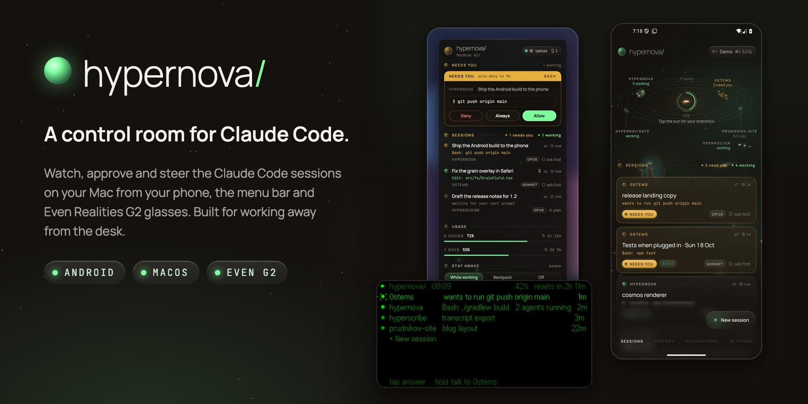
</p>

<h3 align="center">A control room for Claude Code and Codex — hosted on your Mac, your Linux server or in Docker, driven from your phone, your glasses and the Mac's menu bar.</h3>

<p align="center">
  
  
  
  
  
  
  
</p>

<p align="center">
  <a href="https://hypernova.nikbraun.tech"><b>Website</b></a> ·
  <a href="https://github.com/prudnik-web/Hypernova/releases/latest"><b>Download</b></a> ·
  <a href="docs/INSTALL.md"><b>Install guide</b></a> ·
  <a href="https://hypernova.nikbraun.tech/#film-h"><b>Watch the film</b></a>
</p>

---

Claude Code and Codex do their best work when you let them run, and they always need you at the
worst moment: a command to approve, a question to answer, a limit to wait out. **Hypernova** keeps
you in the loop wherever you are. Leave the Mac in your backpack, or the agents on a server, and use
the phone as your window, the glasses as your screen and your voice as the keyboard.

Bring either agent, or both. Hypernova works the same with
[Claude Code](https://docs.claude.com/en/docs/claude-code) alone or with OpenAI's
[Codex](https://github.com/openai/codex) alone. With both, each has its own usage meters, and a
conversation can switch from one to the other mid-chat.

Everything runs on **a computer of your own**, next to your agents: **a Mac** (with a menu bar app),
**a Linux server** (a VPS, a home server, a PC: the `hypernova` command) or **a Docker container**.
The phone and the glasses reach it directly on your Wi-Fi, or over **your own Tailscale network**
from anywhere. No Hypernova server sits in between: the only thing we host is a small name service
for pairing and a private name (see [`docs/SECURITY-MODEL.md`](docs/SECURITY-MODEL.md)).

## Highlights

<table>
  <tr>
    <td width="33%" align="center">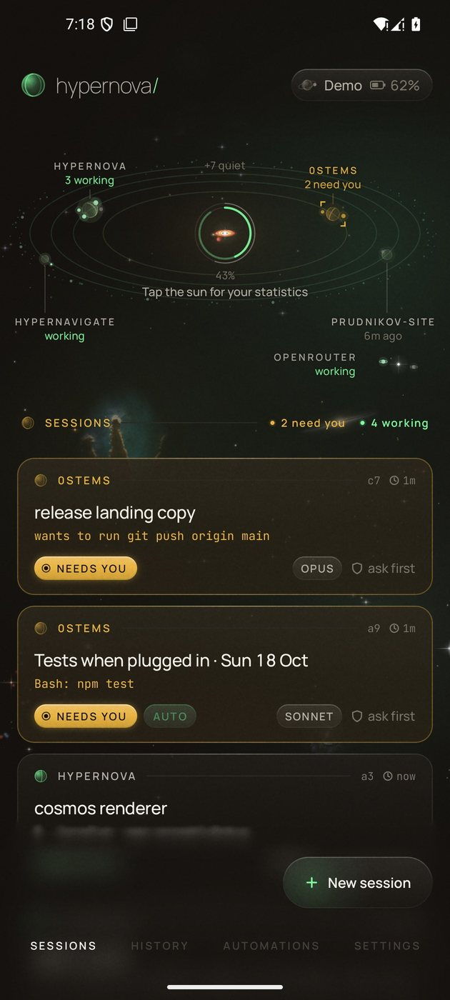</td>
    <td width="33%" align="center">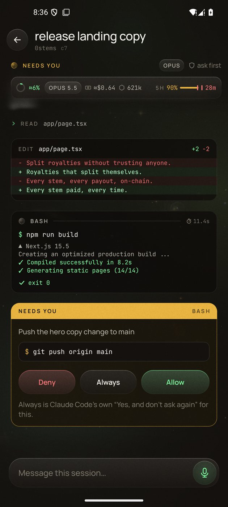</td>
    <td width="33%" align="center">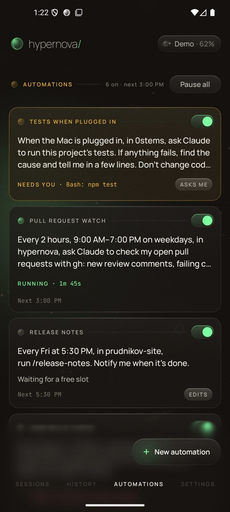</td>
  </tr>
  <tr>
    <td align="center"><b>Your sessions as a sky.</b><br><sub>The sun is an accretion disk, and the disk is your 5-hour window: it drains as you spend it, goes dark at the limit and refills when the window resets. Projects orbit it as planets; Codex beside Claude Code is a second star.</sub></td>
    <td align="center"><b>Approve from anywhere.</b><br><sub>Live output and the real terminal. Allow, deny or answer from the phone; risky commands get a second look.</sub></td>
    <td align="center"><b>Automations.</b><br><sub>Morning briefs, "carry on after the limit", tests when the Mac is plugged in. Never on paid credits without your yes.</sub></td>
  </tr>
  <tr>
    <td align="center">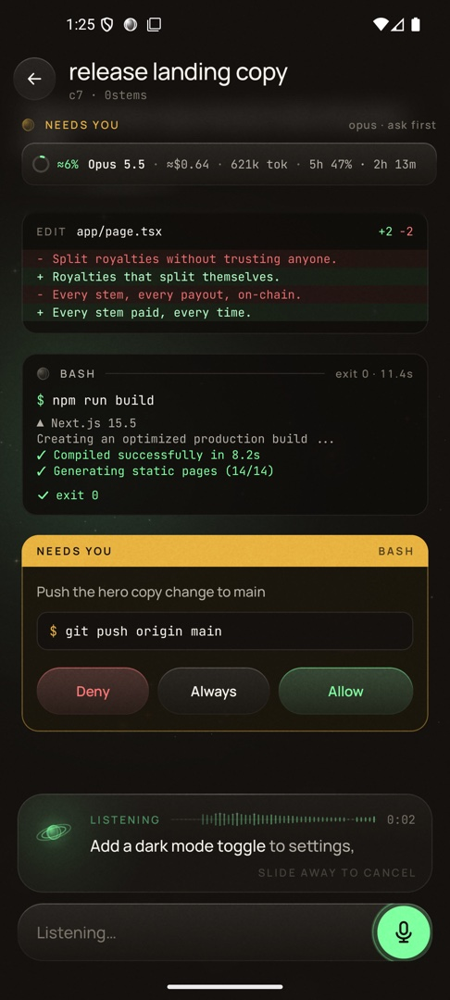</td>
    <td align="center">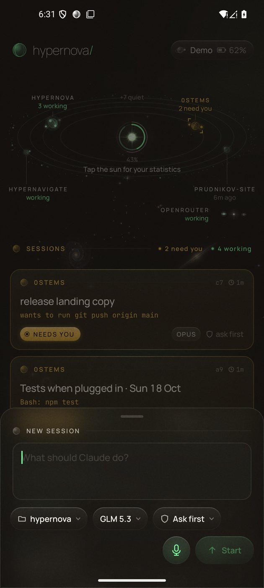</td>
    <td align="center">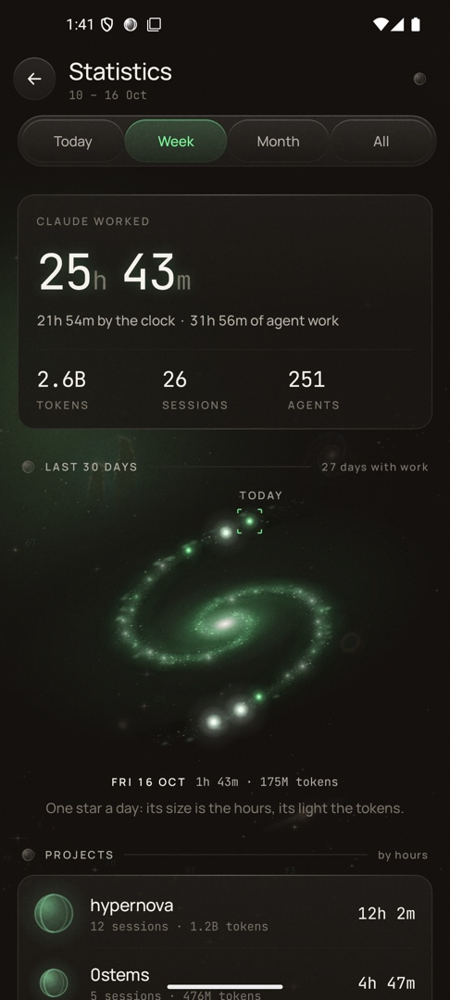</td>
  </tr>
  <tr>
    <td align="center"><b>Talk to it.</b><br><sub>Real-time speech recognition (Soniox), and replies read aloud through your headphones.</sub></td>
    <td align="center"><b>Start anything.</b><br><sub>Type or say the prompt, then pick a project (found by a few letters), the agent, a model and a mode. Claude Code runs on any provider: Anthropic, OpenRouter or your own gateway.</sub></td>
    <td align="center"><b>Honest statistics.</b><br><sub>Hours, tokens and sessions, both agents' and each one's, not badges. Each day is a star in a galaxy.</sub></td>
  </tr>
</table>

<table>
  <tr>
    <td width="25%" align="center">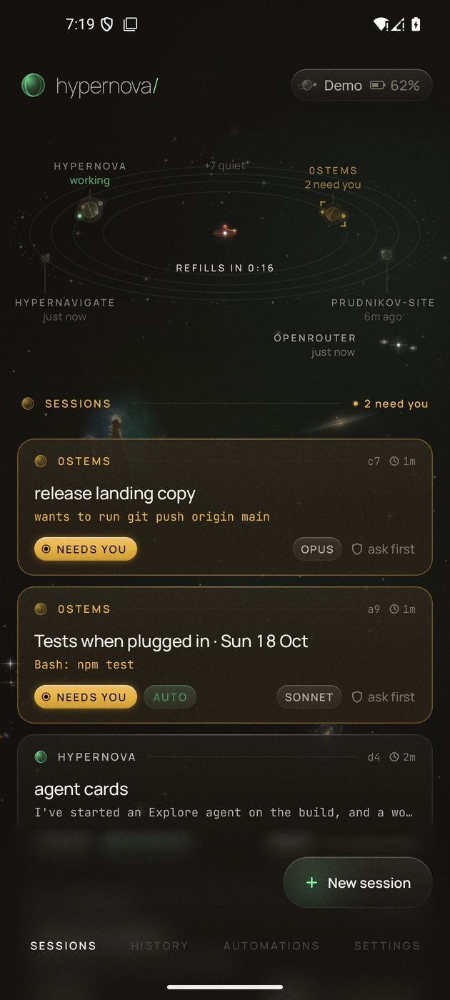</td>
    <td width="25%" align="center">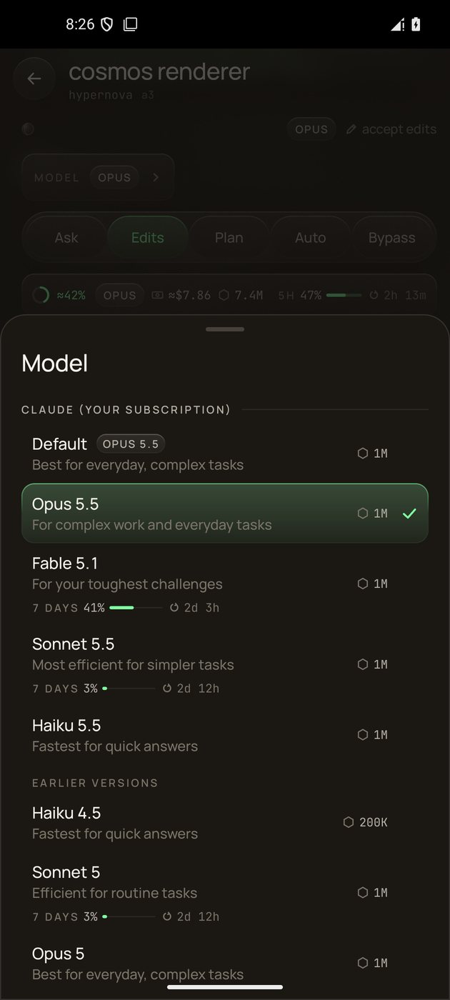</td>
    <td width="25%" align="center">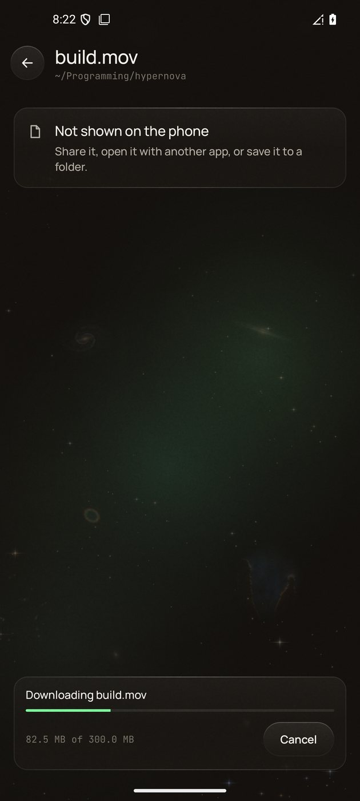</td>
    <td width="25%" align="center">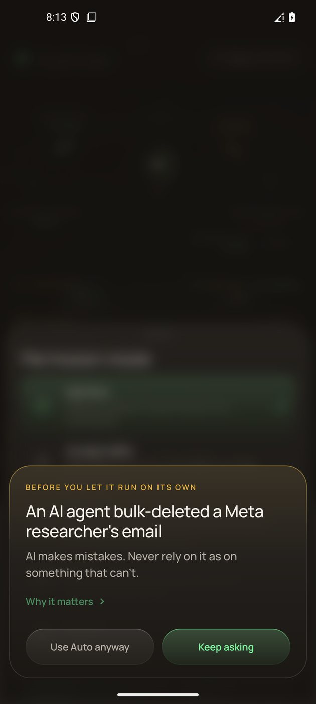</td>
  </tr>
  <tr>
    <td align="center"><sub><b>Limits you can read.</b> The disk empties, then a countdown.</sub></td>
    <td align="center"><sub><b>Switch models,</b> or agents, in the chat.</sub></td>
    <td align="center"><sub><b>Files and downloads</b> from your computer.</sub></td>
    <td align="center"><sub><b>Calm pop-ups,</b> one short line.</sub></td>
  </tr>
</table>

### Also on the phone

- **Claude Code and Codex as equals.** Start a session on either one. "Switch to Codex" (or to
  Claude) carries a conversation over with as much of it as you choose. Each agent has its own
  usage meters ("Claude usage", "Codex usage"), and Codex sessions run in its sandbox, Read only or
  Can edit, asking you for more.
- **Connect your way.** Pair by scanning a QR code or tapping a link (`https://hypernova.observer/pair#…`
  opens the app). On your Wi-Fi the phone talks to the computer directly over mutual TLS ("Local first, always");
  away from home it uses Tailscale, the Tailscale app or Hypernova's own built-in node. Settings keeps a
  connection log of every decision.
- **Notifications you can act on.** Allow and Deny right on an approval's notification (after unlocking),
  a Reply field, and attention cards on Home (a limit, a provider's trouble) you swipe away, with Undo.
- **Files and downloads.** Browse a session's folder, view a file, download it with progress and resume
  and Share, Save or Open with it. Files with keys stay on the computer.
- **Updates in the app.** A Mac hands the phone a newer app, and the app installs it, signed with the
  same key or not at all.
- **Telescope.** See what your agent built: the session's terminal, a local web page, an Android emulator
  or iOS simulator, a window or an image. Watch it refresh live.
- **Stay awake and Backpack.** Keep a Mac working with its lid closed in a bag, with battery and
  heat guards. Get "+2 h" before Backpack ends.
- **Limits that explain themselves.** See when a limit lifts (Claude's and Codex's), a "Continue
  now" button when Claude Code would carry on by itself, and other providers' credit and rate limits.
- **Everyday tools.** The context ring and session cost, the agent's to-do list, Rewind, quick
  prompts, what changed (with diffs and a Commit button), the share target, launcher shortcuts and
  home screen widgets.
- **After a restart.** Sessions cut short by a reboot wait on Home with "Resume". History keeps 30
  days.

## In the menu bar

<p align="center">
  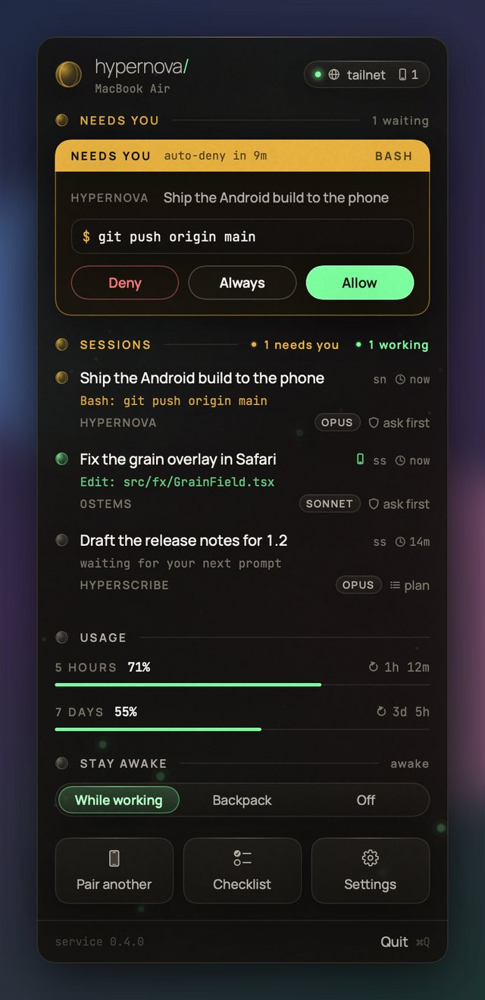
  &nbsp;&nbsp;
  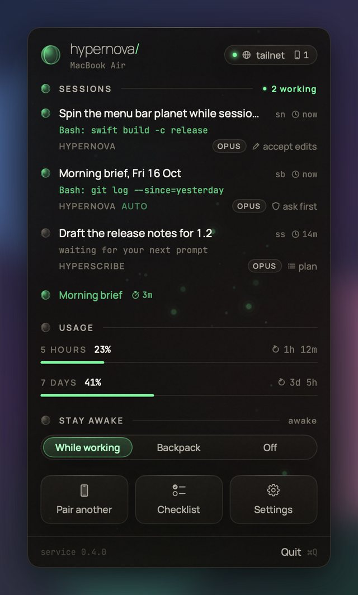
</p>

A planet in the menu bar spins while anything works and shows a dot when something needs you. The
popover is the phone's design on the Mac: approvals, sessions in the phone's words, drawn usage meters
that show where your pace is heading, Stay awake and automations. The Mac app also installs and runs the
daemon, sets up the `claude` and `codex` shell integration and Tailscale (or Hypernova's own), pairs phones with a
QR code and lists the ones you trust, so you can forget one at any time. On a Linux server the
`hypernova` command does those jobs over SSH: `setup`, `pair` (the code right in the terminal),
`codex on`, `status` and `doctor`.

## On your glasses

<p align="center">
  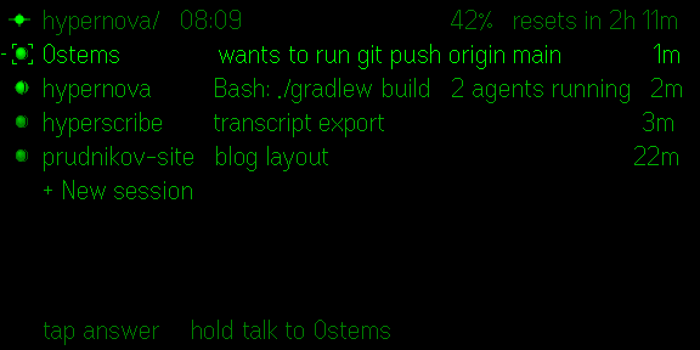
  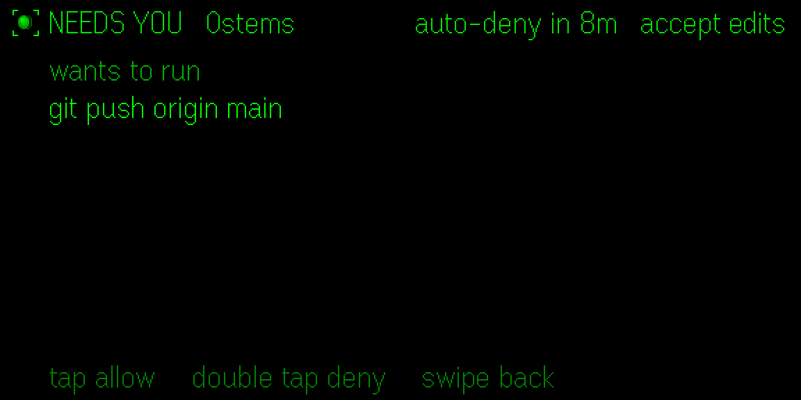
</p>
<p align="center">
  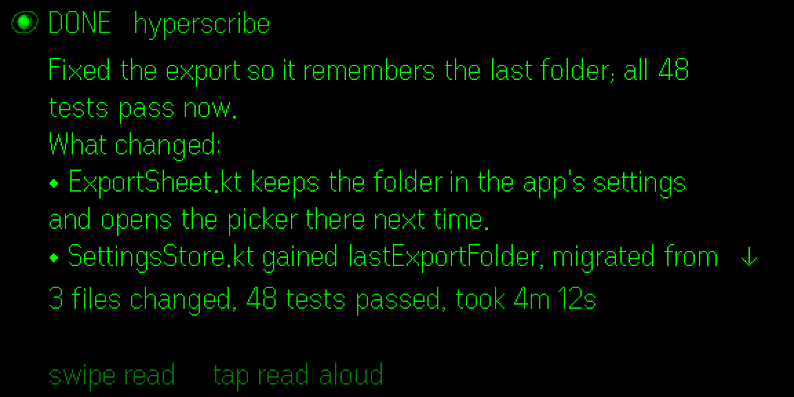
  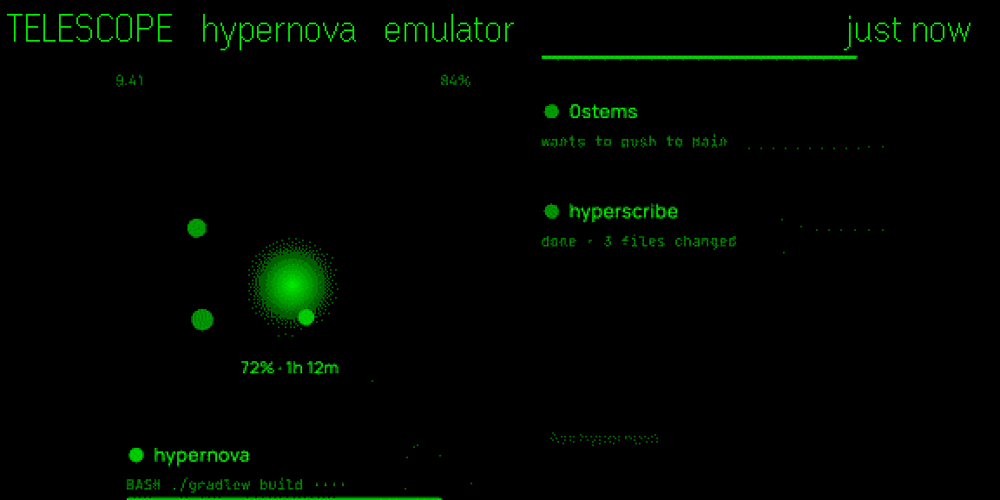
</p>

**Hypernova Lens** runs on Even Realities G2 glasses. You glance at your sessions, hold the temple
to talk, approve by tap or by voice ("approve push"), hear results read aloud and look through
Telescope. It uses the glasses' own text, in the same words as the phone. There are modes for walking
and cycling, a debrief, and voice notes. Lens connects through the Hypernova app on the same phone:
you allow it once by comparing a six-digit code. See
[`lens/README.md`](lens/README.md).

## How it works

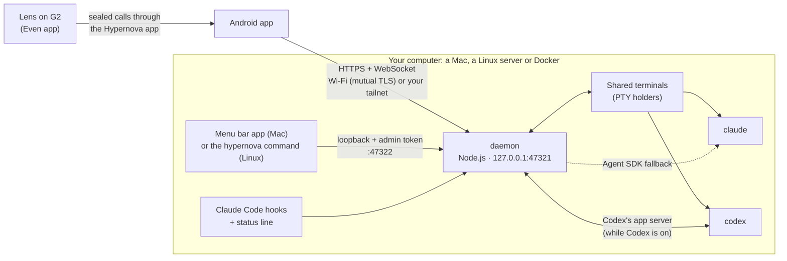

- **The daemon** (`daemon/`, TypeScript run directly by Node.js 22.18 or newer, no build step)
  watches every Claude Code session on the computer through hooks and transcripts, and Codex's
  through Codex's own app server (only while you use Codex). It runs the phone's sessions in
  **shared terminals**: you can take the same live terminal over from the phone or from any
  terminal on the computer, over SSH too (`hn attach`). It serves the phone API on loopback, exposed only through Tailscale (the app's `tailscale serve` or its own built-in node) and, on your Wi-Fi, a mutual-TLS listener.
- **The Android app** (`android/`, Kotlin and Jetpack Compose) and **the glasses app** (`lens/`,
  TypeScript and Vite on the Even Hub SDK) talk to the same API.
- **The Mac app** (`mac/`, SwiftUI, built with SwiftPM and no Xcode) is the menu bar, the setup and
  the service manager on a Mac. On Linux, **the `hypernova` command** (`daemon/src/cli/`) installs
  the daemon as a systemd user service and does the same jobs from a terminal.

[`docs/PROTOCOL.md`](docs/PROTOCOL.md) is the full contract between them.

## Getting started

**You need:**

- A computer to host it: a Mac with Apple silicon on macOS 14 or later, a Linux machine on Ubuntu
  or Debian (x86_64 or arm64, a VPS or a home server), or Docker.
- An agent on it, signed in: [Claude Code](https://docs.claude.com/en/docs/claude-code), OpenAI's
  [Codex](https://github.com/openai/codex) 0.163.0 or later, or both. Either one alone is enough, and
  Hypernova installs Claude Code for you if you want it.
- An Android phone running Android 10 or later.
- Optional: a [Tailscale](https://tailscale.com) account, to reach the computer from anywhere (always,
  for a VPS; the Tailscale app is optional too: Hypernova carries its own node). On the same Wi-Fi
  nothing else is needed.
- Optional: Even Realities G2 glasses, and a [Soniox](https://soniox.com) API key for voice.

**Install** from the [latest release](../../releases/latest) (`SHA256SUMS.txt` has the checksums).
The whole guide, with the first launch on each macOS version and every Linux step, is
[`docs/INSTALL.md`](docs/INSTALL.md).

*On a Mac:*

1. Download `Hypernova.dmg` and `Hypernova.apk`.
2. Open the disk image and drag **Hypernova** onto **Applications**.
3. Open it. Hypernova isn't notarized by Apple, so the first time macOS stops it: in **System Settings
   → Privacy & Security**, click **Open Anyway** (on macOS 14, Control-click the app and choose
   **Open**).
4. Setup walks you through seven steps: **Claude Code**, **Background service**, **Connect Claude
   Code**, **Tailscale**, **Voice**, **Codex** and **Your phone**. With Codex alone, **Use Codex only**
   skips Claude Code's two.
5. Install the app on your phone (or scan **Get the app** in Setup), then scan the pairing code. Later,
   **Pair a phone** in the menu bar pairs another.

*On a Linux server* (as the user who'll run the agents, not root):

```bash
tmp=$(mktemp -d) && tar -xzf Hypernova-linux.tar.gz -C "$tmp" && "$tmp"/hypernova-*/scripts/install-linux.sh
claude                  # sign in to Claude Code once (the script installed it; --no-claude: Codex alone)
hypernova codex on      # optional: Codex, installed and signed in (codex login --device-auth)
hypernova pair          # Tailscale's sign-in, then the pairing code, right in the terminal
```

Install `Hypernova.apk` on your phone and scan the code. `hypernova doctor` checks every piece.

*In Docker:* `docker build -t hypernova .` from a clone of this repository, `docker run` it with a
volume for its state, then `docker exec -it hypernova hypernova pair` (the exact commands:
[`docs/INSTALL.md`](docs/INSTALL.md#4-in-docker)).

**Build from source:**

```bash
# 1. The Mac app, with the daemon bundled (needs daemon/node_modules: cd daemon && npm ci).
mac/build.sh --open                     # dist/Hypernova.app
mac/build.sh --release && mac/dmg.sh    # dist/Hypernova.dmg, as released

# 2. The Android app (Android Studio's JDK). The Mac app also bundles the APK and serves it on
#    its download page.
cd android
JAVA_HOME="/Applications/Android Studio.app/Contents/jbr/Contents/Home" ./gradlew :app:assembleDebug

# 3. The glasses app: builds lens/out.ehpk for the Even Hub.
cd lens && npm install && npm run pack
```

**Develop:**

```bash
cd daemon && npx tsc -p . && npm test                  # daemon: typecheck and tests
cd lens && npm test && npx tsc --noEmit -p .           # glasses
cd mac && swift build -c release                       # Mac app
cd android && ./gradlew :app:testDebugUnitTest         # Android unit tests
```

To test alongside a live install, run a second daemon with `HYPERNOVA_SUPPORT`, `HYPERNOVA_LOGS`,
`HYPERNOVA_API_PORT` and `HYPERNOVA_LOCAL_PORT` (see [`CLAUDE.md`](CLAUDE.md)).
`Hypernova --render-popover <dir>` renders the menu bar popover on sample data without a daemon.

## Privacy and safety

- **Yours end to end.** The phone API listens on loopback and is reached through your tailnet or by
  your Wi-Fi's mutual-TLS listener, with a per-device token (and certificate) from pairing; the Mac app
  and the `hypernova` command use an admin token kept in a `0700` folder. [`docs/SECURITY-MODEL.md`](docs/SECURITY-MODEL.md) is the
  full threat model: what runs and is stored where, what Cloudflare, Let's Encrypt and Tailscale see, and
  what is still open.
- **Keys stay on your computer.** Provider and Soniox keys are never logged, never sent to the phone, and
  only ever go to their own provider.
- **Voice is opt-in.** Audio goes to Soniox only when you turn voice on with your own key. On a Mac,
  its own voices are the fallback for reading aloud.
- **Guard rails.** Risky commands (force pushes, `rm -rf`, deploys) need their own verb by voice.
  "Bypass" mode asks you to think twice first. Automations never run on usage credits or another
  paid provider unless you agree, and they never close or copy your own sessions.

## Repository

| Path | What |
| --- | --- |
| [`android/`](android) | The Android app (Kotlin, Jetpack Compose), its widgets and tests |
| [`mac/`](mac) | The menu bar app (SwiftUI, SwiftPM) with setup, the popover and developer renders |
| [`daemon/`](daemon) | The daemon (TypeScript on Node.js): sessions, hooks, Codex, shared terminals, automations, speech |
| [`lens/`](lens) | Hypernova Lens for Even Realities G2 (TypeScript, Vite, Even Hub SDK) |
| [`skills/hyper-cosmos/`](skills/hyper-cosmos) | The "digital cosmos" design language, as a Claude Code skill |
| [`docs/`](docs) | [Protocol](docs/PROTOCOL.md), [security model](docs/SECURITY-MODEL.md), [decisions](docs/DECISIONS.md), [design](docs/DESIGN.md), [later](docs/LATER.md), [Linux and Docker](docs/LINUX.md), [specs](docs/specs), [releasing](docs/RELEASING.md) |
| [`names/`](names) | The name service (a Cloudflare Worker): private names, the pairing page |
| [`third_party/`](third_party) | Fonts (OFL) and xterm.js |

## Status

**Status: alpha.** Expect rough edges and changes between versions. A paired phone can drive Claude
Code and Codex on your computer, so read [`SECURITY.md`](SECURITY.md) and the
[threat model](docs/SECURITY-MODEL.md) before you pair one. To help, see
[`CONTRIBUTING.md`](CONTRIBUTING.md).

Hypernova is a personal project in active development. It is used every day and built with Claude
Code. It isn't in any app store: download it from the releases, or build it yourself. Ideas parked for later are in
[`docs/LATER.md`](docs/LATER.md).

## License

Hypernova is licensed under the **Apache License 2.0** (see [`LICENSE`](LICENSE) and
[`NOTICE`](NOTICE)), **Hypernova Lens** (`lens/`) included (it was AGPL-3.0-or-later up to
0.1.11, while it carried Hyperscribe Companion's client; see [`lens/LICENSE`](lens/LICENSE) and
[`lens/NOTICE`](lens/NOTICE)). Fonts and code in `third_party/` keep their own licenses.

<p align="center"><sub>Claude and Claude Code are products of Anthropic; Codex is a product of OpenAI. Hypernova is an independent project and is not affiliated with Anthropic, OpenAI or Even Realities.</sub></p>
