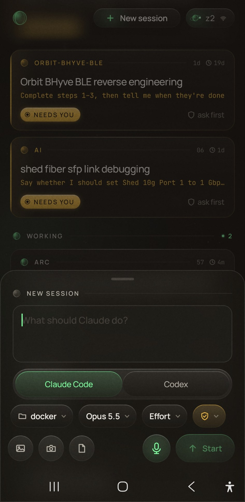

# Hypernova

**Your Claude Code and Codex fleet, in your pocket.**

Hypernova is an Android app and a small server you run on your own machines. Pair one server or
several and every agent you're running lands in one list, grouped by what needs you, what's working
and what's done, with Allow and Deny right on the card.

[Releases](https://github.com/ljmerza/Hypernova/releases/latest) ·
[Install guide](docs/INSTALL.md) ·
[Linux server](docs/LINUX.md) ·
[Protocol](docs/PROTOCOL.md)

<table>
  <tr>
    <td></td>
    <td></td>
    <td></td>
    <td></td>
    <td></td>
  </tr>
  <tr>
    <td>Home</td>
    <td>A session</td>
    <td>New session</td>
    <td>Statistics</td>
    <td>Automations</td>
  </tr>
</table>

Left alone these agents are separate terminals on separate machines, each with its own limits, and a
remote terminal only gets you one screen at a time and a phone keyboard to type `y` with. Hypernova
reads the sessions, so a permission prompt becomes a card with the command on it and a code change
becomes a diff. The real terminal is still there when you want it.

**Run a fleet.** All servers puts every machine's sessions on one Home and in one searchable History.
Each card names its server and your answer goes straight to it. A new session asks where to start.
Codex sits next to Claude Code with its own usage meters, and you can hand a conversation from one to
the other after reading and editing what it carries over.

**Never block an agent.** A command that needs you shows up with Allow and Deny on its card, in its
notification and on a home screen widget, and Allow only shows there when you can read the whole
command. You can reply to a finished session from its notification too. Claude Code's own terminal
dialogs become cards, and if you're away its asks wait for you instead of getting auto-denied.

**Take the wheel.** Run `claude` at your desk and it's on your phone too, in the same shared terminal,
along with your `claude agents` jobs. Send a message mid-turn and it queues. Open the live terminal,
read the diffs, browse the files, switch model, effort or mode while a session runs, or rewind a
Claude Code conversation to an earlier message. See each agent's settings per server and change a set
list of them, with Undo. See which MCP servers a Claude Code session has set up and restart it to
reload them.

**Put it on autopilot.** Each server runs its own automations, so your phone can be off. Start one on
a schedule, when a usage window resets, when a session finishes, when a file changes or when a GitHub
PR opens. String steps together, shell commands included, and a run can stop to ask you something you
answer right from the notification.

**Know your usage.** Every server gets a meter for each agent's limits. Statistics adds up your hours
and tokens for today, the week, the month or the year so far, with the last 30 days as bars. When a
limit stops a Claude Code session it says so and can carry on by itself after the reset, or you can
move it to another provider.

**No cloud in between.** Today's Android app talks straight to your server over your Wi-Fi or your own
VPN, with mutual TLS and a certificate per phone. There's no Hypernova account and no Hypernova
server, and notifications come over that same connection with no push service involved.

This page is the short version and the app already does a lot more. Reading replies aloud and pasting
a screenshot into a prompt didn't even make the cut. [`docs/FEATURES.md`](docs/FEATURES.md) has the
whole list, over 160 capabilities with the tests that guard each one and a plain note where they only
partly do, and it's a long scroll.

Setup is a `curl` line, a sign-in and a QR code.

## Install

**The server**, on Ubuntu or Debian (x86_64 or arm64), as the user who'll run the agents, not root.

```bash
curl -fsSL https://ljmerza.github.io/Hypernova/get.sh | bash
```

That installs the system packages it needs (it asks for sudo), Node.js, the Hypernova service and
Claude Code. Then sign in to Claude Code once and pair your phone.

```bash
claude
hypernova pair
```

**The client**: install the Android app from the
[latest release](https://github.com/ljmerza/Hypernova/releases/latest)
(`hypernova-client-<tag>-android.apk`, Android 10 or later) and scan the QR code `hypernova pair` shows.
`hypernova doctor` checks every piece if something doesn't work.

The server updates itself to new releases (`hypernova auto-update off` turns that off), and the same
`curl` line updates it by hand. Each release also has the server as a `.deb`
(`hypernova-server-<tag>-linux-amd64.deb`, then `hypernova-server-setup`). Docker and the manual steps
are in [`docs/LINUX.md`](docs/LINUX.md).

The same `curl` line installs the server on a Mac, which hasn't been tried on a real one yet and doesn't
update itself: [`docs/INSTALL.md`, "On a Mac"](docs/INSTALL.md#on-a-mac-untested-on-a-real-one).

## Where it's going

None of this is built yet, and these aren't promises. A desktop client for Linux, Mac and Windows is
next, so the same control room sits on your desk, then an Apple version and maybe a web version after
that. I also want the phone to control all of each agent's settings instead of today's set list. An
iPhone version's notifications would have to go through Apple's push, so "no cloud in between" is a
claim about today's Android app. The server on a Mac is a separate thing and still hasn't been tried
on a real one, as Install says.

## Privacy

The phone API only listens on the server itself and is reached through a mutual-TLS listener on
your network (port `47323`), with a certificate and token per paired phone. Provider keys never
leave the server, and dictation uses your phone's speech recognizer (as your keyboard's voice
typing does), or on-device only if you choose. The full threat model is in
[`docs/SECURITY-MODEL.md`](docs/SECURITY-MODEL.md).

## Develop

```bash
cd daemon && npm ci && npx tsc -p . && npm test       # the server
cd android && ./gradlew :app:assembleDebug :app:testDebugUnitTest   # the app (JDK 21, Android SDK)
```

[`CLAUDE.md`](CLAUDE.md) explains how to run a second server next to a live install for testing.

## License

Apache License 2.0, see [`LICENSE`](LICENSE) and [`NOTICE`](NOTICE). Claude and Claude Code are
products of Anthropic, Hypernova isn't affiliated with Anthropic. Codex is a product of OpenAI, and
Hypernova isn't affiliated with OpenAI either.

Hypernova began as a fork of [prudnik-web/Hypernova](https://github.com/prudnik-web/Hypernova) by
Nikita Prudnikov, under the Apache License 2.0.
