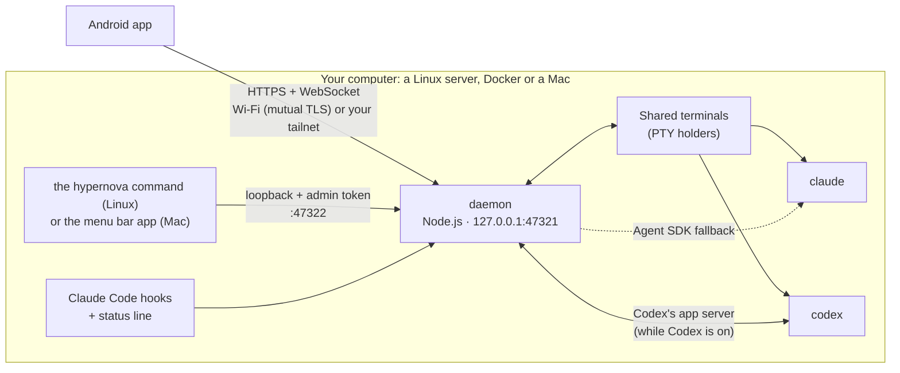

# Hypernova

**A control room for Claude Code and Codex: hosted on your Linux server, driven from your Android
phone.**

[Download](https://github.com/ljmerza/Hypernova/releases/latest) ·
[Install guide](docs/INSTALL.md) ·
[Linux server](docs/LINUX.md) ·
[Protocol](docs/PROTOCOL.md)

This is a fork of [prudnik-web/Hypernova](https://github.com/prudnik-web/Hypernova), set up for one
Linux server and an Android phone. The Mac app (`mac/`) is upstream's: its sources are here, but this
fork doesn't build or release it.

---

Claude Code and Codex do their best work when you let them run, and they always need you at the
worst moment: a command to approve, a question to answer, a limit to wait out. **Hypernova** keeps
you in the loop wherever you are. Leave the agents on a server, and use the phone as your window and
your voice as the keyboard.

Bring either agent, or both. Hypernova works the same with
[Claude Code](https://docs.claude.com/en/docs/claude-code) alone or with OpenAI's
[Codex](https://github.com/openai/codex) alone. With both, each has its own usage meters, and a
conversation can switch from one to the other mid-chat.

Everything runs on **a computer of your own**, next to your agents: **a Linux server** (a VPS, a home
server, a PC: the `hypernova` command), **a Docker container** or, with upstream's app, **a Mac**.
The phone reaches it directly on your Wi-Fi, or over **your own Tailscale network**
from anywhere. No Hypernova server sits in between: the only thing upstream hosts is a small name
service for pairing and a private name (see [`docs/SECURITY-MODEL.md`](docs/SECURITY-MODEL.md)).
**A Windows PC** runs the Linux service inside WSL 2 or Docker Desktop: **experimental**, documented
but not yet tried on a real Windows PC ([`docs/INSTALL.md`](docs/INSTALL.md#5-windows-experimental-wsl2-or-docker-desktop)).

## Highlights

- **Your sessions as a sky.** The sun is an accretion disk, and the disk is your 5-hour window: it
  drains as you spend it, goes dark at the limit and refills when the window resets. Projects orbit
  it as planets; Codex beside Claude Code is a second star.
- **Approve from anywhere.** Live output and the real terminal. Allow, deny or answer from the phone;
  risky commands get a second look.
- **Automations.** Morning briefs, "carry on after the limit", scheduled tests. Never on paid credits
  without your yes.
- **Talk to it.** Dictation with the phone's own on-device recognizer, and replies read aloud through
  your headphones.
- **Start anything.** Type or say the prompt, then pick a project (found by a few letters), the
  agent, a model and a mode. Claude Code runs on any provider: Anthropic, OpenRouter or your own
  gateway.
- **Honest statistics.** Hours, tokens and sessions, both agents' and each one's, not badges. Each
  day is a star in a galaxy.
- **Limits you can read.** The disk empties, then a countdown.
- **Switch models,** or agents, in the chat.
- **Files and downloads** from your computer.
- **Calm pop-ups,** one short line.

### Also on the phone

- **Claude Code and Codex as equals.** Start a session on either one. "Switch to Codex" (or to
  Claude) carries a conversation over with as much of it as you choose. Each agent has its own
  usage meters ("Claude usage", "Codex usage"), and Codex sessions run in its sandbox, Read only or
  Can edit, asking you for more.
- **Connect your way.** Pair by scanning a QR code or tapping a link (`https://hypernova.observer/pair#…`
  opens the app). On your Wi-Fi the phone talks to the computer directly over mutual TLS ("Local first, always");
  away from home it uses Tailscale, the Tailscale app or Hypernova's own built-in node. Settings keeps a
  connection log of every decision.
- **Notifications you can act on.** Allow and Deny right on an approval's notification (after unlocking),
  a Reply field, and attention cards on Home (a limit, a provider's trouble) you swipe away, with Undo.
- **Files and downloads.** Browse a session's folder, view a file, download it with progress and resume
  and Share, Save or Open with it. Files with keys stay on the computer.
- **Updates in the app.** A Mac running upstream's app hands the phone a newer app, and the app
  installs it, signed with the same key or not at all. From a Linux server, install the newer APK
  from the releases over the old one.
- **Stay awake and Backpack** (on a Mac). Keep a Mac working with its lid closed in a bag, with
  battery and heat guards. Get "+2 h" before Backpack ends.
- **Limits that explain themselves.** See when a limit lifts (Claude's and Codex's), a "Continue
  now" button when Claude Code would carry on by itself, and other providers' credit and rate limits.
- **Everyday tools.** The context ring and session cost, the agent's to-do list, Rewind, quick
  prompts, what changed (with diffs and a Commit button), the share target, launcher shortcuts and
  home screen widgets.
- **After a restart.** Sessions cut short by a reboot wait on Home with "Resume". History keeps 30
  days.

## On the server

On a Linux server the `hypernova` command does the jobs a menu bar app would, over SSH: `setup`,
`pair` (the code right in the terminal), `codex on`, `status` and `doctor`. Upstream's Mac app is a
menu bar planet with the same approvals, sessions and usage meters; this fork doesn't build it.

## How it works



- **The daemon** (`daemon/`, TypeScript run directly by Node.js 22.18 or newer, no build step)
  watches every Claude Code session on the computer through hooks and transcripts, and Codex's
  through Codex's own app server (only while you use Codex). It runs the phone's sessions in
  **shared terminals**: you can take the same live terminal over from the phone or from any
  terminal on the computer, over SSH too (`hn attach`). It serves the phone API on loopback, exposed only through Tailscale (the app's `tailscale serve` or its own built-in node) and, on your Wi-Fi, a mutual-TLS listener.
- **The Android app** (`android/`, Kotlin and Jetpack Compose) talks to that API.
- **The `hypernova` command** (`daemon/src/cli/`) installs the daemon on Linux as a systemd user
  service and runs setup, pairing and checks from a terminal. Upstream's **Mac app** (`mac/`,
  SwiftUI) does the same on a Mac.

[`docs/PROTOCOL.md`](docs/PROTOCOL.md) is the full contract between them.

## Getting started

**You need:**

- A Linux server on Ubuntu or Debian (x86_64 or arm64, a VPS or a home server) with systemd, sudo
  for the system packages, and a normal user to run it as. Or Docker. Or, experimentally, a Windows
  PC with WSL 2 or Docker Desktop.
- An agent on it, signed in: [Claude Code](https://docs.claude.com/en/docs/claude-code), OpenAI's
  [Codex](https://github.com/openai/codex) 0.163.0 or later, or both. Either one alone is enough, and
  Hypernova installs Claude Code for you if you want it.
- An Android phone running Android 10 or later.
- Optional: a [Tailscale](https://tailscale.com) account, to reach the computer from anywhere (always,
  for a VPS; the Tailscale app is optional too: Hypernova carries its own node). On the same Wi-Fi
  nothing else is needed.

**1. Install the server**, as the user who'll run the agents (not root). Either from the
[latest release](https://github.com/ljmerza/Hypernova/releases/latest)'s server package,
`hypernova-server-<tag>-linux.tar.gz` (one package for x86_64 and arm64):

```bash
gh release download -R ljmerza/Hypernova -p 'hypernova-server-*-linux.tar.gz'   # or save it from the release page
tmp=$(mktemp -d) && tar -xzf hypernova-server-*-linux.tar.gz -C "$tmp" && "$tmp"/hypernova-*/scripts/install-linux.sh
```

or from a clone of this repository:

```bash
git clone https://github.com/ljmerza/Hypernova.git && cd Hypernova
scripts/install-linux.sh    # system packages (with sudo), Node.js 24, the daemon, its service
```

Then sign in to your agents:

```bash
claude                      # sign in to Claude Code once (the script installed it; --no-claude: Codex alone)
hypernova codex on          # optional: Codex, installed and signed in (codex login --device-auth)
```

The script ends with `hypernova setup`: the daemon as a systemd user service, the `hypernova`
command, Claude Code's hooks and the `claude` shell function. Every step and option:
[`docs/LINUX.md`](docs/LINUX.md).

**2. Pair the phone.** Install the app from the
[latest release](https://github.com/ljmerza/Hypernova/releases/latest) (`hypernova-<tag>.apk`), then
on the server:

```bash
hypernova pair          # a QR code and a link, right in the terminal
```

**3. Scan the code** with the phone's camera, or open the link on the phone (or copy it and use
**Paste pairing link** in the app). `hypernova doctor` checks every piece.

*In Docker:* `docker build -t hypernova .` from a clone of this repository, `docker run` it with a
volume for its state, then `docker exec -it hypernova hypernova pair` (the exact commands:
[`docs/INSTALL.md`](docs/INSTALL.md#4-in-docker)).

*On Windows (experimental):* the Linux steps inside WSL 2 (Ubuntu), with Claude Code and Codex
installed there too, or the Docker steps in Docker Desktop; the phone pairs over the built-in
Tailscale. Nobody has tried it on a Windows PC yet: [`docs/INSTALL.md`](docs/INSTALL.md#5-windows-experimental-wsl2-or-docker-desktop)
has the steps and what is and isn't verified.

*On a Mac:* upstream's [releases](https://github.com/prudnik-web/Hypernova/releases) have the Mac
app; this fork doesn't build it.

**Build the Android app from source** (JDK 21 and the Android SDK):

```bash
cd android
./gradlew :app:assembleDebug            # app/build/outputs/apk/debug/
```

**Develop:**

```bash
cd daemon && npx tsc -p . && npm test                  # daemon: typecheck and tests
cd android && ./gradlew :app:testDebugUnitTest         # Android unit tests
```

To test alongside a live install, run a second daemon with `HYPERNOVA_SUPPORT`, `HYPERNOVA_LOGS`,
`HYPERNOVA_API_PORT` and `HYPERNOVA_LOCAL_PORT` (see [`CLAUDE.md`](CLAUDE.md)).

## Privacy and safety

- **Yours end to end.** The phone API listens on loopback and is reached through your tailnet or by
  your Wi-Fi's mutual-TLS listener, with a per-device token (and certificate) from pairing; the
  `hypernova` command uses an admin token kept in a `0700` folder. [`docs/SECURITY-MODEL.md`](docs/SECURITY-MODEL.md) is the
  full threat model: what runs and is stored where, what Cloudflare, Let's Encrypt and Tailscale see, and
  what is still open.
- **Keys stay on your computer.** Provider keys are never logged, never sent to the phone, and
  only ever go to their own provider.
- **Voice stays on the phone.** Dictation uses the phone's own on-device recognizer, so the audio never
  leaves it. Replies are read aloud by the phone's voice (or a Mac's own).
- **Guard rails.** "Bypass" mode asks you to think twice first. Automations never run on usage credits or another
  paid provider unless you agree, and they never close or copy your own sessions.

## Repository

| Path | What |
| --- | --- |
| [`android/`](android) | The Android app (Kotlin, Jetpack Compose), its widgets and tests |
| [`daemon/`](daemon) | The daemon (TypeScript on Node.js): sessions, hooks, Codex, shared terminals, automations, the `hypernova` command |
| [`scripts/`](scripts) | The Linux install script and the server package's packer |
| [`mac/`](mac) | Upstream's menu bar app (SwiftUI, SwiftPM); not built in this fork |
| [`skills/hyper-cosmos/`](skills/hyper-cosmos) | The "digital cosmos" design language, as a Claude Code skill |
| [`docs/`](docs) | [Install](docs/INSTALL.md), [Linux and Docker](docs/LINUX.md), [protocol](docs/PROTOCOL.md), [security model](docs/SECURITY-MODEL.md), [decisions](docs/DECISIONS.md), [design](docs/DESIGN.md), [later](docs/LATER.md), [specs](docs/specs), [releasing](docs/RELEASING.md) |
| [`names/`](names) | The name service (a Cloudflare Worker): private names, the pairing page |
| [`third_party/`](third_party) | Fonts (OFL) and xterm.js |

## Status

**Status: alpha.** Expect rough edges and changes between versions. A paired phone can drive Claude
Code and Codex on your computer, so read [`SECURITY.md`](SECURITY.md) and the
[threat model](docs/SECURITY-MODEL.md) before you pair one. To help, see
[`CONTRIBUTING.md`](CONTRIBUTING.md).

Hypernova is a personal project in active development. It isn't in any app store: download it from
the [releases](https://github.com/ljmerza/Hypernova/releases), or build it yourself. Ideas parked for
later are in [`docs/LATER.md`](docs/LATER.md).

## License

Hypernova is licensed under the **Apache License 2.0** (see [`LICENSE`](LICENSE) and
[`NOTICE`](NOTICE)). Fonts and code in `third_party/` keep their own licenses.

Claude and Claude Code are products of Anthropic; Codex is a product of OpenAI. Hypernova is an
independent project and is not affiliated with Anthropic or OpenAI.
