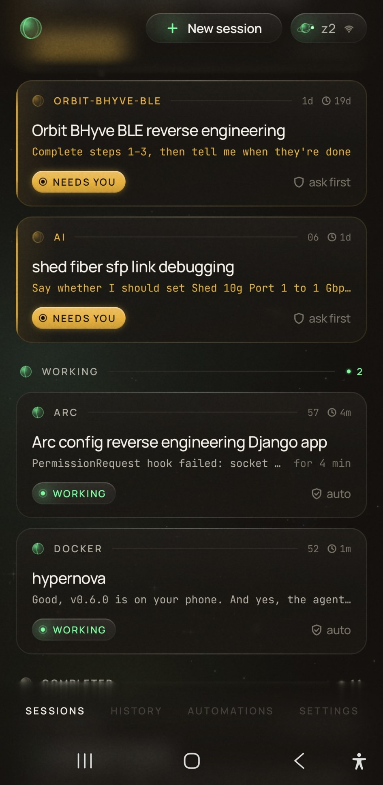
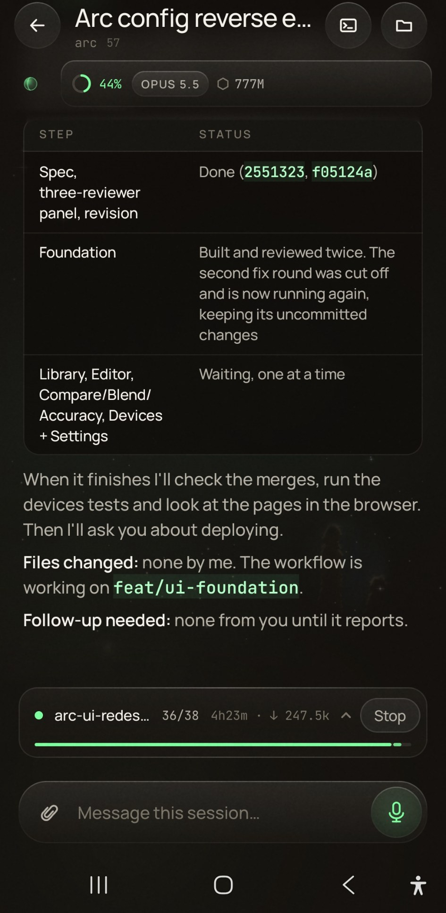
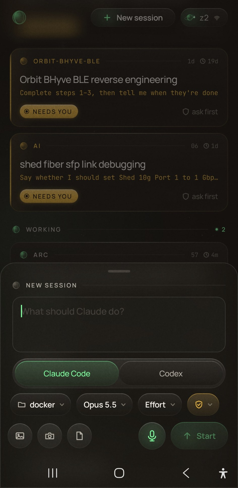
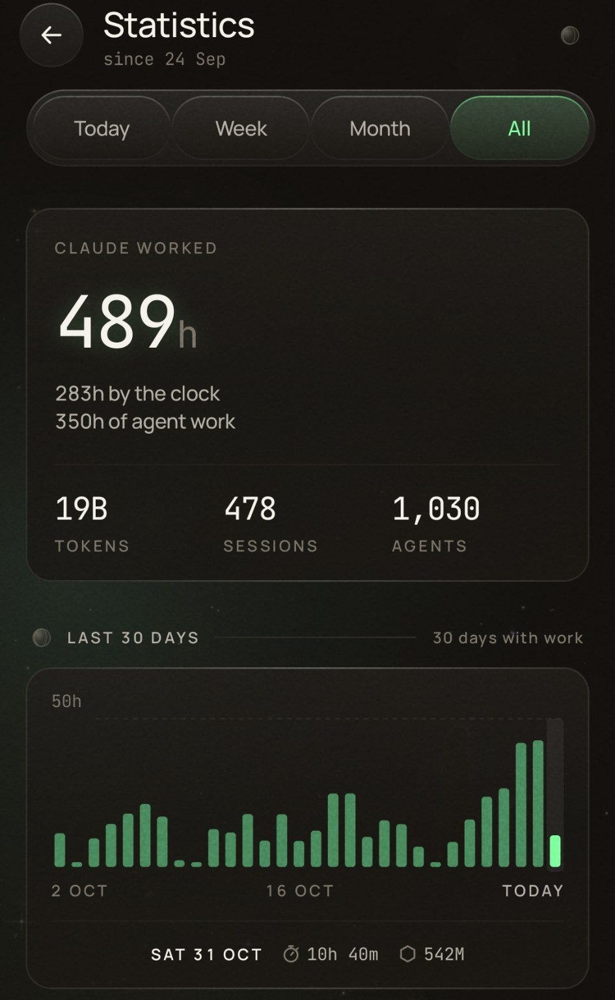
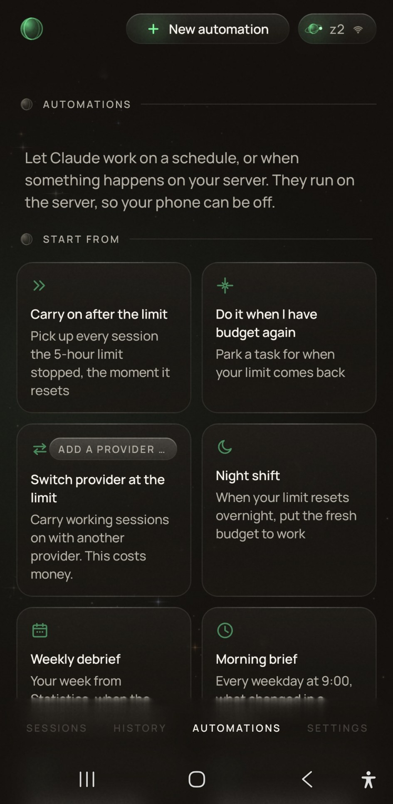

# Hypernova

Hypernova lets you run Claude Code agents on your own Linux server and drive them from an Android
phone. You approve or deny what they want to do, answer their questions, start new sessions and
follow along, from the couch or from anywhere you have a VPN into your network. Nothing goes
through a cloud service of ours, the phone talks straight to your server.

[Releases](https://github.com/ljmerza/Hypernova/releases/latest) ·
[Install guide](docs/INSTALL.md) ·
[Linux server](docs/LINUX.md) ·
[Protocol](docs/PROTOCOL.md)

<table>
  <tr>
    <td></td>
    <td></td>
    <td></td>
    <td></td>
    <td></td>
  </tr>
  <tr>
    <td>Home</td>
    <td>A session</td>
    <td>New session</td>
    <td>Statistics</td>
    <td>Automations</td>
  </tr>
</table>

## Install

**The server**, on Ubuntu or Debian (x86_64 or arm64), as the user who'll run the agents, not root.

```bash
curl -fsSL https://ljmerza.github.io/Hypernova/get.sh | bash
```

That installs the system packages it needs (it asks for sudo), Node.js, the Hypernova service and
Claude Code. Then sign in to Claude Code once and pair your phone.

```bash
claude
hypernova pair
```

**The client**: install the Android app from the
[latest release](https://github.com/ljmerza/Hypernova/releases/latest)
(`hypernova-client-<tag>-android.apk`, Android 10 or later) and scan the QR code `hypernova pair` shows.
`hypernova doctor` checks every piece if something doesn't work.

The server updates itself to new releases (`hypernova auto-update off` turns that off), and the same
`curl` line updates it by hand. Each release also has the server as a `.deb`
(`hypernova-server-<tag>-linux-amd64.deb`, then `hypernova-server-setup`). Docker and the manual steps
are in [`docs/LINUX.md`](docs/LINUX.md).

The same `curl` line installs the server on a Mac, which hasn't been tried on a real one yet and doesn't
update itself: [`docs/INSTALL.md`, "On a Mac"](docs/INSTALL.md#on-a-mac-untested-on-a-real-one).

## What you can do from the phone

- See every session grouped by what needs you, what's working and what's done, with Allow and Deny
  right on the card
- Answer Claude Code's own permission prompts and questions, nothing gets auto-denied
- Send messages while an agent is busy, they're queued and sent when it's ready
- Open the live terminal of any session
- Change the mode and effort of a running session, run slash commands and ask `/btw`
  questions from the session's details
- Start new sessions in any project folder
- Search the full text of past sessions
- Run automations on a schedule, use several servers, and dictate with the phone's own voice
  recognition

Claude Code's background agents (`claude agents`) show up as sessions too: on by default, and
Settings → Agents & providers → Claude Code in the app turns it off.

## Privacy

The phone API only listens on the server itself and is reached through a mutual-TLS listener on
your network (port `47323`), with a certificate and token per paired phone. Provider keys never
leave the server, and dictation uses your phone's speech recognizer (as your keyboard's voice
typing does), or on-device only if you choose. The full threat model is in
[`docs/SECURITY-MODEL.md`](docs/SECURITY-MODEL.md).

## Develop

```bash
cd daemon && npm ci && npx tsc -p . && npm test       # the server
cd android && ./gradlew :app:assembleDebug :app:testDebugUnitTest   # the app (JDK 21, Android SDK)
```

[`CLAUDE.md`](CLAUDE.md) explains how to run a second server next to a live install for testing.

## License

Apache License 2.0, see [`LICENSE`](LICENSE) and [`NOTICE`](NOTICE). Claude and Claude Code are
products of Anthropic, Hypernova isn't affiliated with Anthropic.
