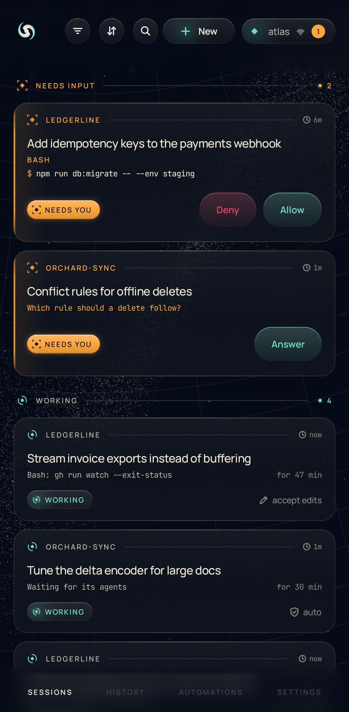
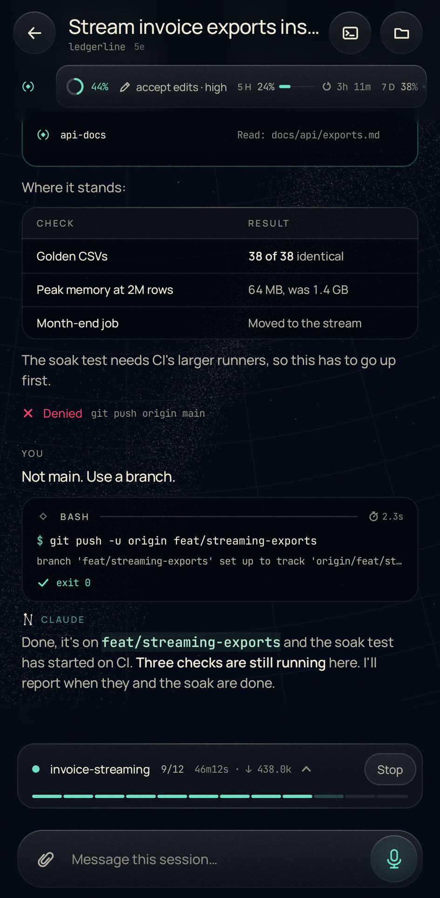
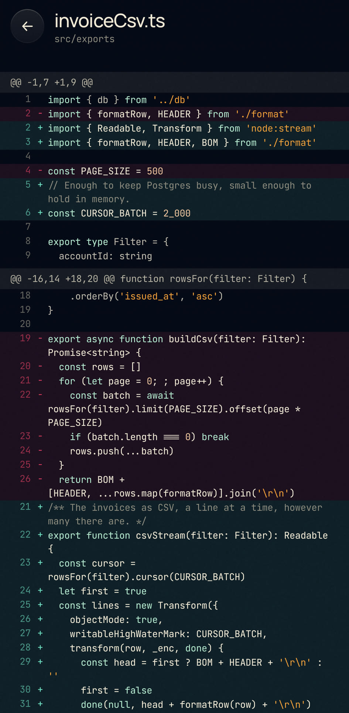
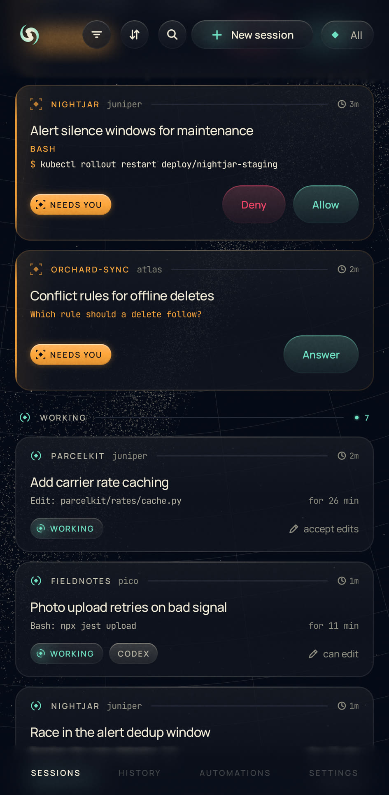
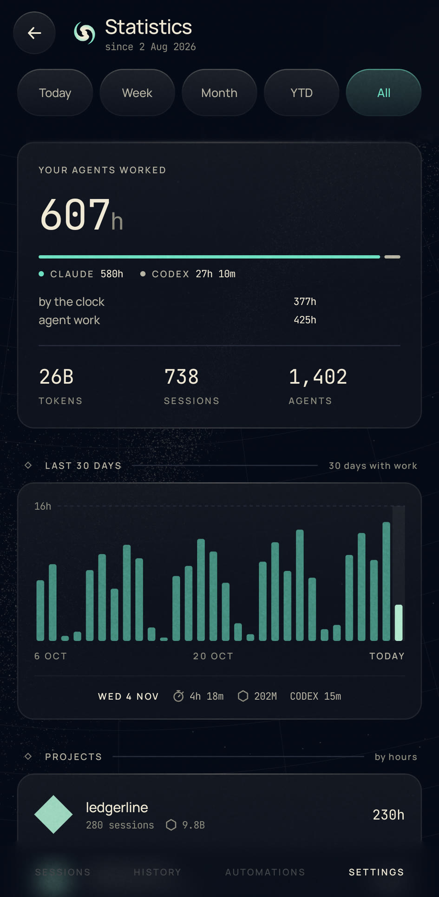
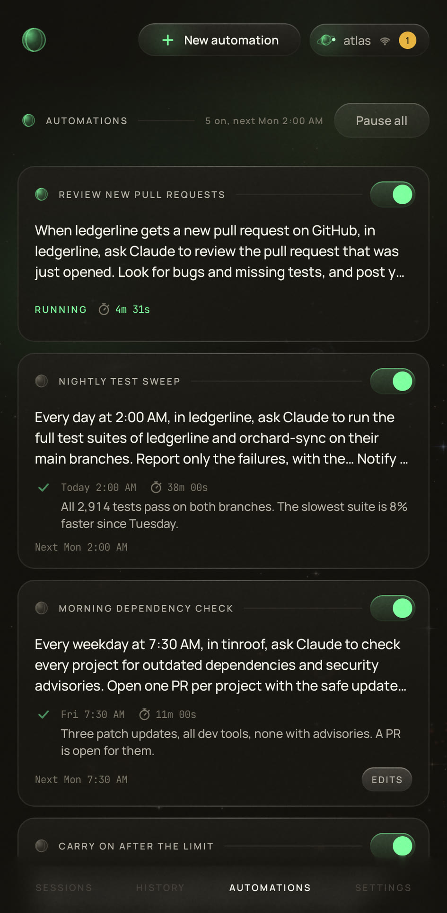

<!-- Modified by Leonardo Merza, 2026. See NOTICE. -->
# Hypernova

**Your Claude Code and Codex fleet, in your pocket.**

Hypernova is an Android app and a small server you run on your own machines. Pair one server or
several and all your agents show up in one list, with the ones that need you at the top.

[Releases](https://github.com/ljmerza/Hypernova/releases/latest) · [Install guide](docs/INSTALL.md) ·
[Linux server](docs/LINUX.md) · [Protocol](docs/PROTOCOL.md)

<table>
  <tr>
    <td></td>
    <td></td>
    <td></td>
    <td></td>
    <td></td>
    <td></td>
  </tr>
  <tr>
    <td>Home</td>
    <td>A session</td>
    <td>Code review</td>
    <td>All servers</td>
    <td>Statistics</td>
    <td>Automations</td>
  </tr>
</table>

This is a real interface for your agents, not a terminal on a phone. You do far more than approve,
with diffs, settings and automations on screens you tap and the live terminal there when you want it.

- **Run a fleet.** Choose All servers and every machine's sessions share one Home and one searchable
  History. Codex sits next to Claude Code, and a conversation can move from one to the other.
- **Never block an agent.** Walk away and your phone tells you when one needs you. Allow or deny a
  command from its card, its notification or a widget, and a notification or widget only offers Allow
  when you can read the whole command. Claude Code's asks never get auto-denied.
- **Take the wheel.** Open the live terminal of a `claude` you started at your desk, read its diffs,
  switch its model or rewind it. You can also see each agent's settings and change a set list of them,
  or see which MCP servers a Claude Code session has set up and restart it to reload them.
- **Put it on autopilot.** Each server runs its own automations, on a schedule or when a usage window
  resets, a session finishes, a file changes or a GitHub PR opens. A run can stop and ask you something.
- **Know your usage.** Every server gets a meter for each agent's limits, and Statistics adds up your
  hours and tokens. A Claude Code session stopped by a limit can carry on by itself after the reset.
- **No cloud in between.** Today's Android app talks straight to your server over your Wi-Fi or your
  own VPN, with mutual TLS. There's no Hypernova account or server and no push service in the way.

That's only the highlights. Over 160 capabilities are already built, each listed with its tests in
[`docs/FEATURES.md`](docs/FEATURES.md). Setup is a `curl` line, a sign-in and a QR code.

## Install

**The server**, on Ubuntu or Debian (x86_64 or arm64), as the user who'll run the agents, not root.

```bash
curl -fsSL https://ljmerza.github.io/Hypernova/get.sh | bash
```

(`get-server.sh` is the same file, to go with the client's `get-client.sh` below. `get.sh` isn't going anywhere.)

That installs the system packages it needs (it asks for sudo), Node.js, the Hypernova service and
Claude Code. Log out and back in, or open a new SSH session, for your PATH and the `claude` function.
Then sign in to Claude Code once and pair your phone.

```bash
claude
hypernova pair
```

**The client**: install the Android app from the
[latest release](https://github.com/ljmerza/Hypernova/releases/latest)
(`hypernova-client-<tag>-android.apk`, Android 10 or later), tap **Scan** in it and point it at the QR code `hypernova pair` shows.
`hypernova doctor` checks every piece if something doesn't work. A small desktop client for Linux, Mac and Windows is on
each release too, and on Linux or a Mac this installs it:

```bash
curl -fsSL https://ljmerza.github.io/Hypernova/get-client.sh | bash
```

It's unsigned, so Windows warns, and a Mac does for a browser's download, and that line has only run on Linux so far: [`docs/INSTALL.md`, "The desktop client"](docs/INSTALL.md#the-desktop-client).

The server updates itself to new releases (`hypernova auto-update off` turns that off), and the same
`curl` line updates it by hand. Each release also has the server as a `.deb`
(`hypernova-server-<tag>-linux-amd64.deb`, then `hypernova-server-setup`). Docker and the manual steps
are in [`docs/LINUX.md`](docs/LINUX.md).

The same `curl` line installs the server on a Mac; it has run on GitHub's Mac runners, but not yet on a person's own Mac, and it doesn't
update itself: [`docs/INSTALL.md`, "On a Mac"](docs/INSTALL.md#on-a-mac).

## Where it's going

None of this is built yet, and these aren't promises. The desktop client only pairs, lists and approves so
far; making it the same control room on your desk is next, then an Apple version and maybe a web version after
that. I also want the phone to control all of each agent's settings instead of today's set list. An
iPhone version's notifications would have to go through Apple's push, so "no cloud in between" is a
claim about today's Android app. The server on a Mac is a separate thing and has only run on GitHub's
Mac runners so far, as Install says.

## Privacy

The phone API only listens on the server itself and is reached through a mutual-TLS listener on
your network (port `47323`), with a certificate and token per paired phone. Provider keys never
leave the server, and dictation uses your phone's speech recognizer (as your keyboard's voice
typing does), or on-device only if you choose. The full threat model is in
[`docs/SECURITY-MODEL.md`](docs/SECURITY-MODEL.md).

## Develop

```bash
cd daemon && npm ci && npx tsc -p . && npm test       # the server
cd android && ./gradlew :app:assembleDebug :app:testDebugUnitTest   # the app (JDK 21, Android SDK)
```

[`CLAUDE.md`](CLAUDE.md) explains how to run a second server next to a live install for testing.

## License

Apache License 2.0, see [`LICENSE`](LICENSE) and [`NOTICE`](NOTICE). Fonts and code in `third_party/`
keep their own licenses. Modified from the original, see [`CHANGES.md`](CHANGES.md).

Claude and Claude Code are products of Anthropic; Codex is a product of OpenAI. Hypernova is an
independent project and is not affiliated with Anthropic or OpenAI.

Hypernova began as a fork of [prudnik-web/Hypernova](https://github.com/prudnik-web/Hypernova) by
Nikita Prudnikov, under the Apache License 2.0.
