# Hypernova Lens

Hypernova on Even Realities G2 glasses, so you can keep building with the Mac in your backpack or
the agents on a server: the glasses are the screen, your voice is the keyboard, and your earbuds are
the second screen. Lens talks only to the Hypernova app on the same phone, which carries everything
to the computer Hypernova runs on (a Mac, or a Linux server or container) over its own connection
(that computer's network, or Tailscale), so Lens needs no pairing or address of its own. Nothing
goes through anyone else's server.

This page says "the Mac" throughout. A Linux server works the same way, except for what only a Mac
has: its battery, Stay awake and Backpack, its own voice for reading aloud, and app windows in
Telescope ([docs/LINUX.md](../docs/LINUX.md)).

<p align="center">
  
  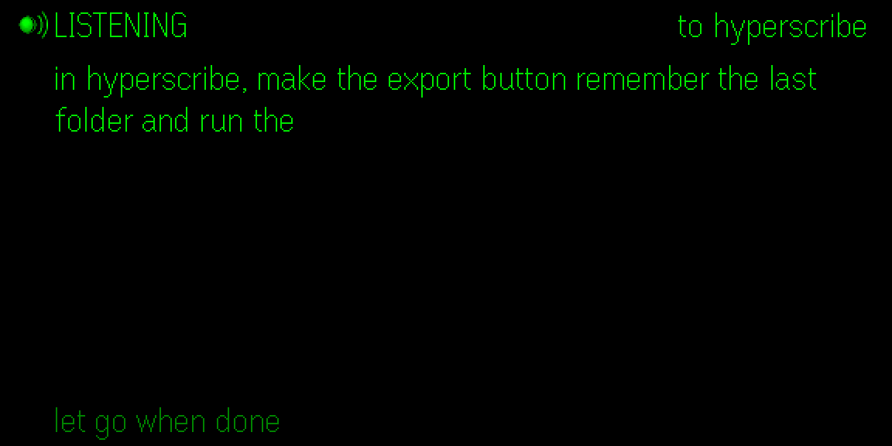
</p>
<p align="center">
  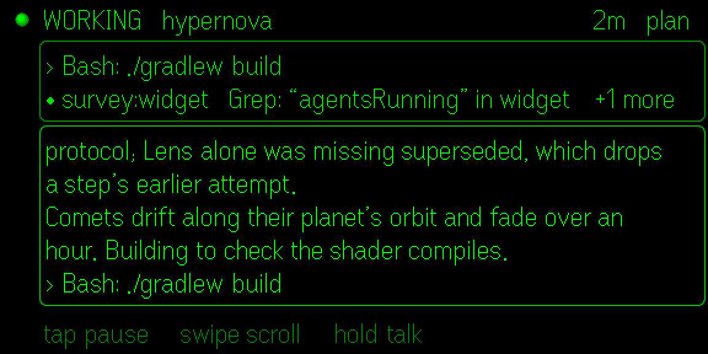
  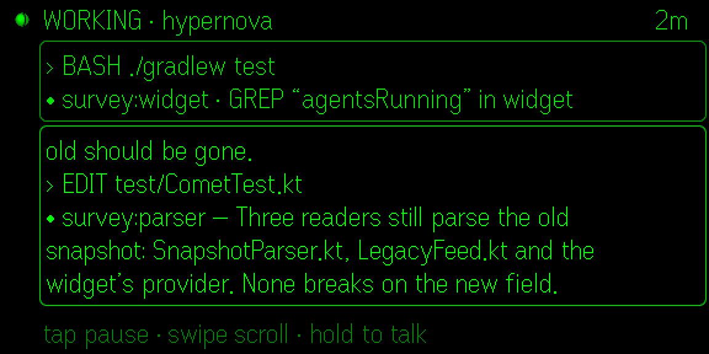
</p>
<p align="center">
  
  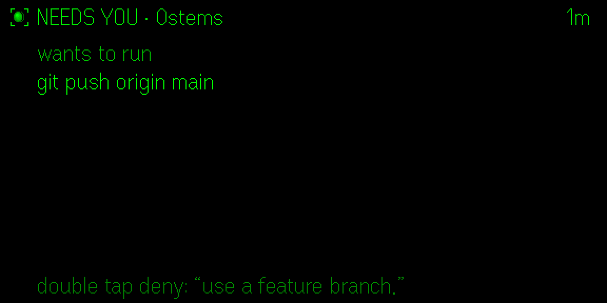
</p>
<p align="center">
  
  
</p>
<p align="center">
  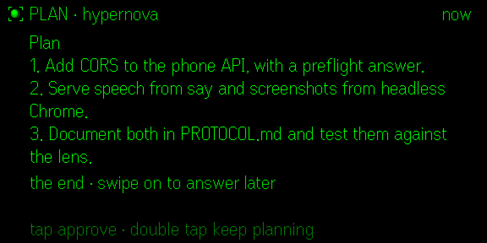
  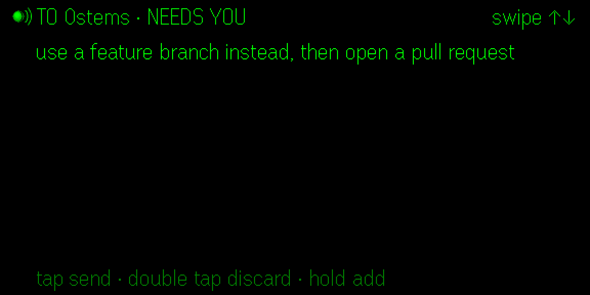
</p>
<p align="center">
  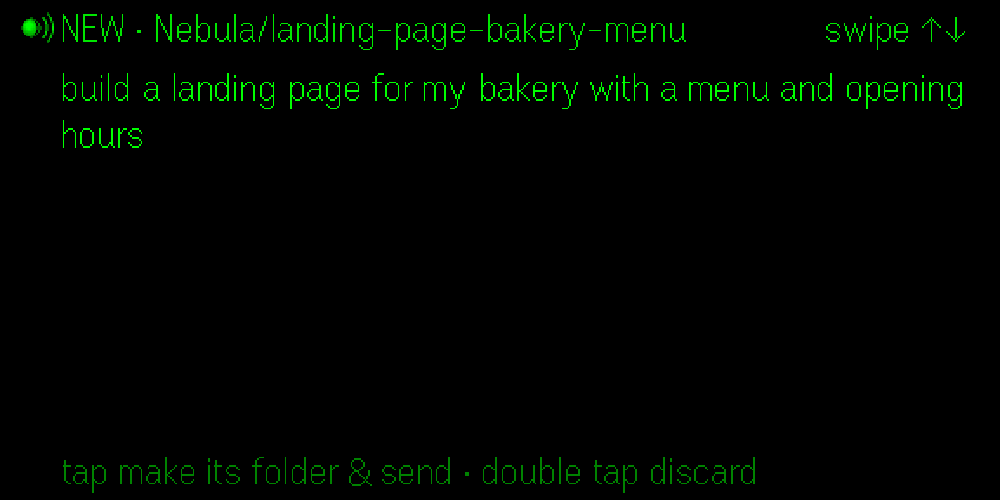
  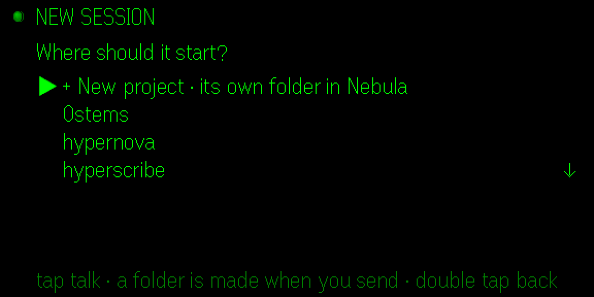
</p>
<p align="center">
  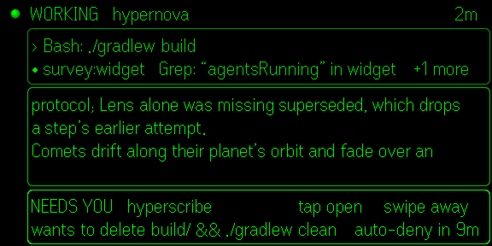
  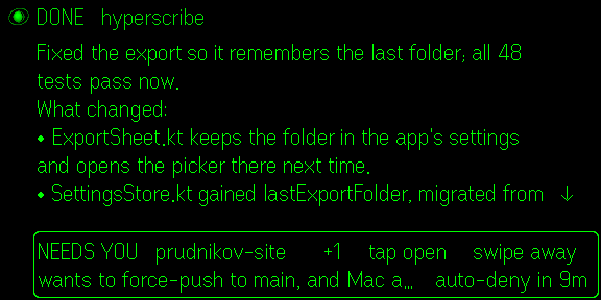
</p>
<p align="center">
  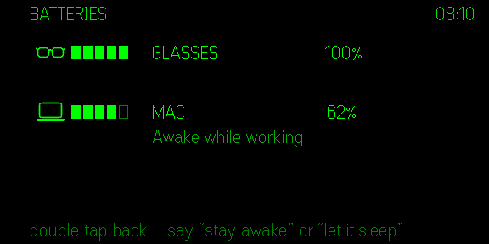
  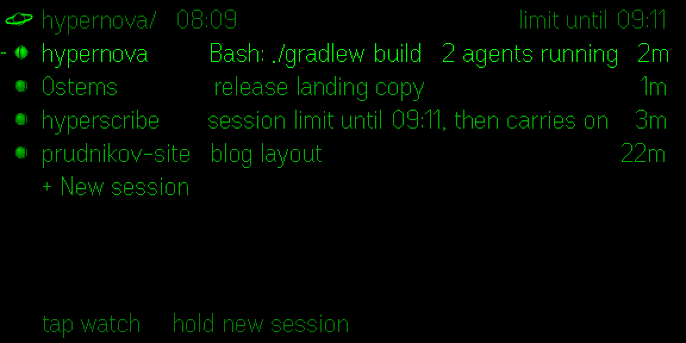
</p>
<p align="center"><sub>The Even Hub simulator 0.9.5 with sample data, shown 2×. The lens is green on the glasses.</sub></p>

## On the glasses

**Glance.** Look up: one line per session that matters (working, needing you, or finished in the
last 45 minutes; four at most), the one that needs you on top, and your 5-hour usage in the corner.
Every line is in the phone's words, its parts a gap apart (never "·"-joined fields): the project in a
column of its own, then what it does. A working line says what Claude runs ("Bash: ./gradlew
build"), and how many agents work alongside it ("2 agents running"); a session whose agents work on
after its turn reads "2 agents running", never done. What needs you is the phone's phrase ("wants to
run git push origin main"), a shorter one ("wants to push to main") when the line has no room; a
push that deletes or forces a branch says so ("wants to force-push to main"). A finished one:
"finished: 3 files, tests pass".
Each line has a small planet, as in the app: it turns while Claude works, sits in a contracting
focus bracket when it needs you, and wears a ring when a reply is waiting. The sun above them is
your usage, drawn as the phone's sky draws it, an accretion disk: a tilted ellipse 2 px tall whose
bright span grows from the centre with the budget left, a one-pixel point (the white dwarf) at its
centre, no pulse (a knot or two circles in only while a session works); at the 5-hour limit a dim
ellipse with the point and one bright pixel on its rim, at the weekly limit the low state (the
stream stopped, the disk drained: the white dwarf a faint point alone), and while usage can't be
followed (signed out, no plan, on hold) an eclipse; when a limit lifts (the week's too), the outburst, the span lighting from the rim in over three frames. The corner says the same in words: "42%
resets in 2h 11m"; "62%   limit in 47m" when, at the pace things run, the limit comes before the
reset (as the phone's red notch and the Mac's arrow warn); "limit until 16:40", "week limit until Fri
10:00", "on usage credits", "signed out". A session a limit paused stays on the glance with the
phone's words ("session limit until 2:00, then carries on", "session limit until 2:00", "paused at the
session limit", "session limit over, ready to continue"), and so does one another provider stops
("OpenRouter is out of credits", "… refused its key", "… is rate limited until 14:05") or one whose
question waited ten minutes and was denied by itself ("paused after 10 minutes without an answer":
open it and tap to continue). Prompts waiting for Claude show whole ("2 queued").
The time is on the top line, next to `hypernova/` (24 hours or AM/PM, as your phone's language
writes it). Under the sessions, **+ New session** (swipe down to it, tap: pick a project).

**Batteries.** Say "battery", or swipe up from the glance's first line: a card with the glasses
and the Mac, each with its own drawn icon, a five-segment bar (one lit per started fifth), the
percent and "charging" ("low" at 20% or less). A Mac without a battery (a Mac mini, an iMac) isn't
listed, and neither is the Mac while it's away (its last level would pass for the current one).
Under the Mac, whether Hypernova keeps it awake: "Awake while working", "Awake with the lid closed
until 18:30" (Backpack), "Sleeps as usual". "Stay awake" keeps it awake with the lid closed (Backpack, once
its one-time setup is done on the Mac; until then, while it works); "let it sleep" undoes that, and
said again turns Stay awake off. Double tap goes back. "status" names a battery only when it runs
low.

**Talk.** Hold the temple and speak; captions appear as you go. Let go and the last words still
come in ("getting the last words…": the microphone stays on 0.4 s for the word you were finishing,
then Soniox settles the end, usually within a second). Then what you said shows whole, a long one
from its end and scrolling, and goes by itself after a count as long as it takes to read: two
seconds for up to two lines ("sending in 2"), a second more for each line after those, eight at most.
Tap to send it at once, double tap to cancel it (nothing is kept). Any swipe pauses the count until
you tap or double tap (a long one scrolls; a short one goes somewhere else: another session, or a
new one), and the top line says "tap to send". If the last words don't
come back within 2.5 s, what was heard stays, the top line says "last words missing?", and it waits
for your tap; a voice word heard that way isn't acted on. The top line always says where it goes.
Inside a session, a hold talks to that session. On the glance, a hold starts a **new session** (once it's sent, that session's live view opens so you watch it start; double tap goes back); when
something needs you (an approval, a question, a plan or a menu, not just a reply waiting) it talks
to that project instead, "TO   0stems   NEEDS YOU", and a swipe switches between the two. Hold again
to add to it (the count starts over on the next release). Start with a project's name to send it
there ("in hyperscribe, fix …"), or start one ("new session in 0stems: …"; "new session: …" for one
of its own). End with "send it" to send it without the count. Said to a session that asks something
first, its card comes up, with what you said ready to go with a deny (double tap), as "deny, …"
would.

**New sessions** are born in **Nebula** (`~/Programming/Nebula` on the Mac; move it in the phone's
Settings), each in a subfolder of its own named from what you said ("build a landing page for my
bakery" → `landing-page-bakery`, `-2` if that's taken) and `git init`ed. The review says "NEW
Nebula/landing-page-bakery", and nothing is made on the Mac before the tap that sends it. By tap:
**+ New session** on the glance opens a picker, "+ New project" (its own folder in Nebula) first,
then your projects, newest first; a pick listens, hands-free.

**Pop-ups.** Over whatever the lens shows, a two-line band says what's worth knowing now: a session
needs you (it stays until you open it or swipe it away), one is done (it fades after about six
seconds), one stopped, a limit hit or lifted, the Mac’s battery at 20%, the Mac about to sleep. Tap
opens it (not in its first moment: that tap was meant for what was there), a swipe puts it away;
several merge into one band ("+2", "0stems and hyperscribe need you"). A needs-you band says how
soon it's denied by itself ("auto-deny in 9m"); another provider's trouble pops up once ("OUT OF
CREDITS   OpenRouter"); Hypernova on the phone no longer answering is a band of its own ("HYPERNOVA
STOPPED / Open Hypernova on your phone"). Nothing pops up while you talk or are read to: they wait and
show after. Over a picture that fills the lens (Telescope's), the band is its top line instead, so
the picture stays whole. Each kind has a switch on the phone; what needs you, the battery and the
Mac about to sleep are on to start with.

**Needs you.** "hypernova wants to run git push origin main": tap allows, double tap denies, a swipe
sets it aside unanswered (it stays first on the glance). Its top line says how soon it's denied by
itself ("auto-deny in 9m") and a mode that isn't the usual ("plan", "accept edits"); Claude's reason
is under the command, and what can't be undone on a line of its own ("careful: force push can't be
undone"). Questions: swipe through the options, tap picks; the last row, "Back   answer later",
leaves it unanswered. Plans: three lines first; swipe to
read it all, one text that scrolls (back past its start, the three lines again). Tap approves,
double tap keeps planning, a swipe past the end sets it aside. A menu in a shared terminal works
like a question. A new approval doesn't take the glance's focus while you're swiping through it, so
a tap opens the line you chose.

**Working.** Tap a working line to watch it, in two boxes. The top one is what runs now: Claude's
tool ("› Bash: ./gradlew build") and a line for each agent at work, newest first ("• survey:parser
Read: Solar.kt", "+2 more" when they don't fit). The bottom one is this turn: what you asked, what
Claude writes, a short line for each run of tools, and each agent's report as it lands. It follows
the newest lines a line at a time, like a teleprompter. Tap pauses it (tap again to go on), swipe
back to read what scrolled away, swipe forward to the end to follow again. Hold to talk to it; a
question it asks comes up on top, and once answered you're back watching. When the job is done it
becomes the result card. Every screen of a session follows it: one that starts working again while
you read its reply shows it working, not its last reply. While the Mac is away, the corner says
"offline since 14:32" instead of a time, and the glance's lines rest as it last said them (their
times stopped, their planets still).

<p align="center">
  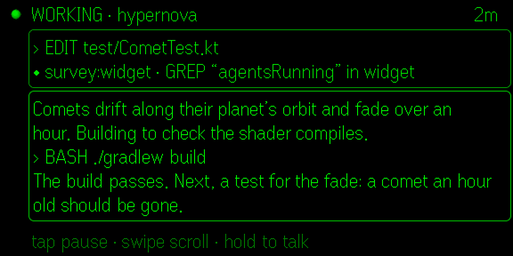
</p>

**Results.** When a session finishes, a soft blip in your earbuds and a card: the reply from its
start, and under it what the session's own events show (files changed, tests passed or failed if a
test command ran, builds, agents it ran, how long it took). The reply is one text that scrolls,
never pages: swipe to read on (a ↓ at the end of the last line says there's more), swipe back to
read it again; tap to have it read into your earbuds (unless reading aloud is off). A turn that ends
while agents it started still work isn't finished: the session stays a working line ("2 agents
running"), and the card comes once, when the last agent has reported. A turn a limit stopped says
"PAUSED", with when Claude is back.

**Text that arrives like speech** (Settings: "Text arrives: Like speech"; "All at once" is the
default). Claude's words in a working session, an agent's report and a finished reply come a few at
a time at a speaking pace (adjustable), with a short pause at a comma and a longer one at a full
stop or a new paragraph. Code and commands appear whole, approvals always at once. A reply arrives
the whole way through its one scrolling text, its newest line in view like the live view's: swipe
back to read what went by (the words go on under it), swipe on to the end to follow again, and a
tap shows the rest at once, under where you are. A reply read aloud follows the voice the same way.
Steps are at least 0.3 s apart, so the glasses get a few text updates a second at most.

**Telescope.** Say "telescope" and the lens fills with what the session in front of you is
building, from wherever it shows: its web page, the Android emulator or a phone, the iOS Simulator,
its terminal (drawn crisp, for command-line work), the last picture, chart or PDF page it made, or
its Mac app's window. The Mac picks what the session touched last; "telescope emulator", "web",
"terminal", "simulator", "image" or "window" picks one yourself. The line on top says what you see:
"TELESCOPE   hyperscribe   web", how old the picture is on its right ("just now"). Tap zooms into a quarter, cut sharp from the full
picture (four bands down a phone's screen); swipe moves round the quarters, double tap zooms out
and then goes back; a tap on a quarter opens the picture on the phone. Say "watch" and it looks
again every few seconds for a minute, sending the glasses only the parts that changed; any gesture
stops it. Windows need Screen Recording for Hypernova on the Mac, asked for once, the first time
you say "telescope window". The Mac tells Soniox the lens's command words, and the lens still knows
"telescope" misheard ("to the scope", "tele scope", "the telescope", "tell a scope") on its own or
before a source ("to the scope terminal"); before anything else those words stay a prompt.

<p align="center">
  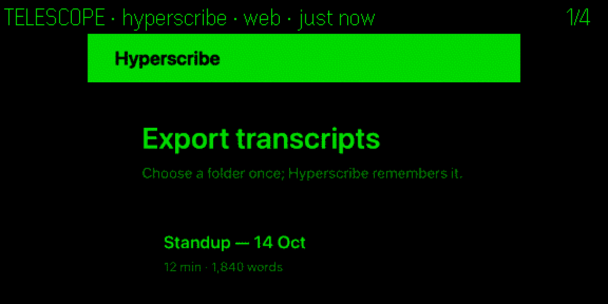
  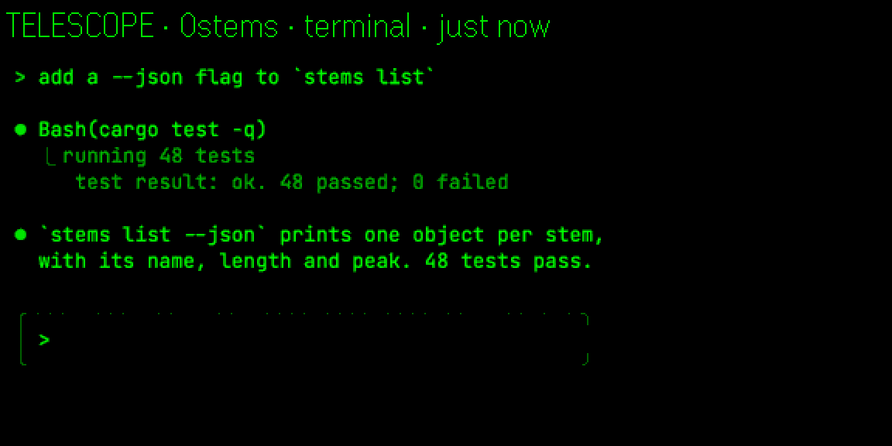
</p>

| Gesture | Glance | Talk | Needs you | Working | Result | Telescope |
|---|---|---|---|---|---|---|
| Hold | what needs you, else a new session | add more | talk (e.g. "deny, use a branch") | talk to that session | talk to that session | talk |
| Tap | open the line; on + New session: pick a project | send now | allow · pick | show the rest (text arriving) · pause · go on | show the rest · read aloud | zoom into a quarter; zoomed: open on the phone |
| Double tap | quiet the lens | cancel (nothing kept) | deny · skip | back | back | zoom out, then back |
| Swipe | move between lines; up from the first: batteries | stop the count; scroll a long one, else send it elsewhere (the needs-you project ↔ a new session first) | options, a plan's text; past the end: back | scroll back · forward (at the end: follow) | scroll back · on (at the end: follow) | zoomed: the next quarter |

With a pop-up on the lens, a tap opens it and a swipe puts it away; hold and double tap do what the
screen under it does. On a debrief, swipe chooses and tap opens; on what changed, tap shows the
diff, and in the diff swipe scrolls (back past its start: the list), tap brings the next file to the
top and double tap goes back.

**Quiet.** Double tap the glance and the lens goes dark; only something that needs you brings it
back. Any tap wakes it.

**The guide.** The first time the glasses have your sessions (and nothing needs you), they offer a
one-minute guide, once: tap to start, double tap for not now. Each step asks for one gesture on the
temple (tap, double tap, swipe, hold) and checks it as you do it: the right one is ticked and says
what it's for ("A tap opens, sends and allows."), a wrong one is named ("That was a swipe. Just one
tap."). The last step is practice for your voice: hold, say anything, let go; what was heard shows
and the step is ticked, and nothing goes to Claude. Voice isn't needed to use Lens, so double tap
skips it.
Once you've learned double tap, it leaves the guide. Say "guide" to play it again, or "Practise the
gestures on the glasses" in the phone's Settings.

**On a bike or a walk.** Say **"moving"** and the lens keeps to two short lines at the top, out of
the way of the road: on the glance the line in focus and where you are ("1 of 4   14:05   42%"), on a
card its head and the one thing to do next. A finished turn is said in one sentence ("hyperscribe
is done: Fixed the export."), each pop-up chimes and takes the first line, and a question is read
out with its numbered options, so **"one"**, **"two"** or **"three"** answers it ("one" and "three",
then "approve", for several). **"Still"** brings the whole lens back. **"Next"** and **"back"** move
without a hand (back leaves a card unanswered, as the menu's Back does). **"Debrief"** says and
lists what finished since you last asked (the first time, the last hour), what needs you and what's
running; the cursor starts on what needs you, so a tap answers it. **"Note: …"** ("note, buy a bell",
"take a note …") keeps the idea as a line in `Nebula/notes.md` on the Mac, with the time and the
project in front of you; Claude isn't started. **"Plan first"** puts the session in front of you in
plan mode and **"go ahead"** back to asking as usual (on a plan they answer it: go ahead approves,
plan first keeps planning); **"continue"** has it carry on where it stopped. Auto and Bypass are
never chosen by voice: the phone asks you to think twice first. **"Eclipse"** lets only what needs
you through, and the Mac's low-battery and 2-minute sleep warnings (no other pop-up, chime or finished turn taking the lens; "eclipse" in the corner) until
**"eclipse off"**. Both moving and eclipse are also switches on the phone.

**Risky commands.** A force push, `rm -rf`, a deploy or a publish, dropping or wiping data, a hard
reset: the card says "careful: force push can't be undone" and how to allow it by voice, its own
verb, **"approve push"** ("approve delete", "approve deploy", "approve publish", "approve drop",
"approve reset"). Plain "approve" and "always" don't allow one, and another kind's verb is
refused ("This one would rm -rf: say “approve delete”"). Still, a tap allows it as before. Moving, a
tap never does: the command is read out first ("Careful. zero stems wants to force push: git push
--force origin main. To allow it, say approve push."), and its verb counts only once that reading
has been heard to the end (talking over it reads it again). Lens reads the command itself
(`src/core/risk.ts`): shell commands word by word through `sudo`, `npx` and the like, SQL by its
keywords, other tools by their names.

**What changed.** **"What changed?"** says what the last turn of the session in front of you
changed, in a sentence or two ("hyperscribe changed ExportSheet.kt, SettingsStore.kt and
ExportFolderTest.kt: 26 lines added, 4 removed. Fixed the export so it remembers the last folder.")
and lists the files with their +/- counts; a tap, or **"show diff"** straight away, shows the diff:
one text that scrolls through every file. Each file after the first begins with its name and counts
on a line of its own ("── PairTest.kt   +3 -0") and the header names the file at the top; each
change says where it is ("… line 41"), + and - sit in a column of their own (in the firmware font a
plus, a hyphen and two spaces are equally wide, so the code lines up), indentation is halved and a
long line wraps under itself, at a bracket or a dot rather than inside a name. Swipe scrolls, tap
brings the next file to the top, double tap goes back. The diff is the one Claude Code made for each
edit, carried in the turn the lens already loads.

<p align="center">
  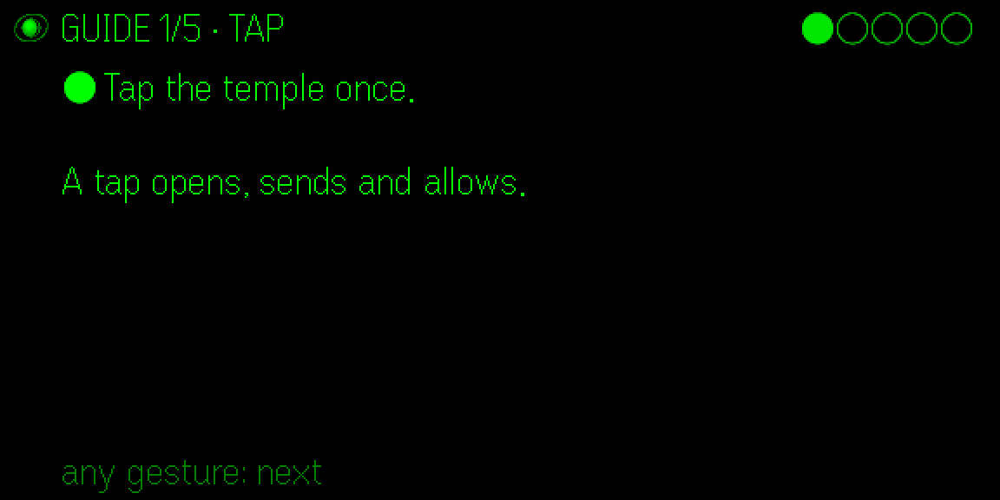
  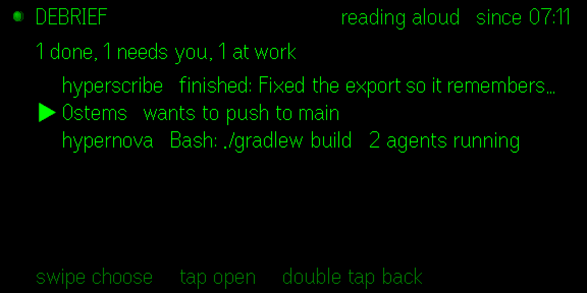
</p>
<p align="center">
  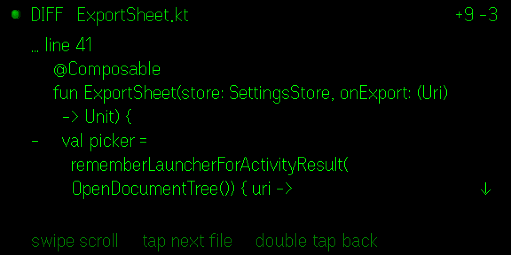
  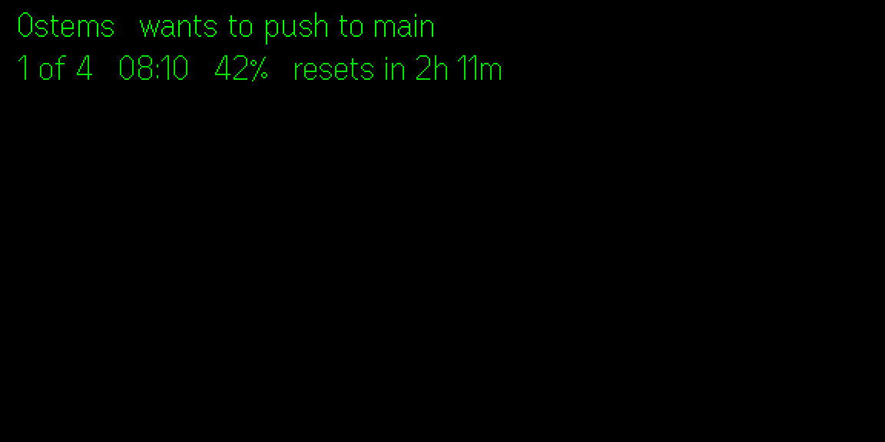
</p>

| Say | Does |
|---|---|
| "status" | reads where every session is (and its agents, and a session a limit paused), your usage or the limit that holds, a battery that runs low, and a Mac kept awake with the lid closed, into your earbuds |
| "approve" / "deny" | answers the card on the lens ("deny, use a feature branch" tells Claude why); anywhere else it brings up what needs you, to read first (a reason said with "deny" stays with a permission's or a plan's card: double tap sends both) |
| "always" | allows once, never the rule: the glasses can't check a fingerprint, so Always is on your phone (the line says "Allowed once. Always is on your phone.") |
| "No, …" | on a card that asks, denies with that reason; anywhere else it's a prompt ("No, use the other file") |
| "stop" | interrupts the session in front of you (Esc) |
| "read the reply" | reads its last reply aloud |
| "mute" (or "quiet") / "unmute" | turns reading aloud off / on, as the phone's switch does: while it's off, a tap and "status" read nothing |
| "send it" | sends what you said (also at the end of a sentence: "fix it and send it") |
| "telescope" (or "show me" on its own) | what the session builds, from where it showed last ("show me the diff" is a prompt) |
| "telescope emulator" / "web" / "terminal" / "simulator" / "image" / "window", "telescope localhost 3000", "… port 5173", "telescope pdf page 3" | that source, page or PDF page |
| "watch" | the telescope looks again every few seconds for a minute (any gesture stops it) |
| "new session: …", "new project, …" | a new session in a folder of its own in Nebula ("new session in 0stems: …" starts one in that project) |
| "battery" (or "batteries", "power") | the battery card |
| "stay awake" (or "keep the Mac awake", "backpack") | keeps the Mac awake with the lid closed (Backpack), once it's set up on the Mac; until then, while it works |
| "let it sleep" | undoes "stay awake" (awake only while working); said again, Stay awake goes off |
| "never mind" | throws the draft away |
| "guide" | the guide on the glasses: each gesture tried and checked |
| "debrief" (or "catch me up", "what did I miss") | says and lists what finished since you last asked, what needs you, what's running |
| "note: …" (or "note, …", "take a note …", "note to self …") | keeps the idea in `Nebula/notes.md` on the Mac, with the time and the project in front of you; no Claude run ("note that …" is a prompt) |
| "next" / "previous" / "back" | the next line, option, page or quarter / the one before / leave the card unanswered |
| "one" / "two" / "three" (or "option two", "the third one") | answers the question or terminal menu on the lens with that option (several: each number ticks one, then "approve"); anywhere else it brings the question up first |
| "plan first" / "go ahead" | the session in front of you plans first / asks as usual; on a plan, keeps planning / approves it. Auto and Bypass only from the phone |
| "continue" | the session in front of you carries on where it stopped |
| "extend" (also "two more hours", "plus two hours") | Backpack's "+2 h", offered by a pop-up ten minutes before its end |
| "eclipse" / "eclipse off" | only what needs you gets through / everything again |
| "moving" / "still" | two short lines, one sentence per result, a chime per pop-up, risky commands by voice only / the whole lens |
| "approve push" (or "approve delete", "deploy", "publish", "drop", "reset") | allows a risky command, by its own verb; moving, once its reading was heard to the end |
| "what changed?" / "show diff" | says what the last turn changed and lists the files / shows its diff |

The long-press menu (if your glasses show it) has Talk (hands-free: it stops listening after a
pause), Back (leaves a card unanswered), Status, Read the reply, Telescope, Watch, Quiet and Exit.

## On the phone

Inside the Even App, Lens's own screen is one status card: **Connected to Hypernova ✓** with your Mac
and the route ("MacBook Air, on the local network"), or what's missing ("Hypernova isn't open on this
phone", "Allow it on your phone" with the code and where Hypernova asks, "Update Hypernova Lens",
"Hypernova can't reach your Mac"), in the same words as the glasses, with **Open Hypernova**
(Lens asks the app to open at Settings → Glasses: it does when it's on screen, else its notification
"Tap to open Hypernova" does it on a tap), **Ask again** and **Disconnect**. Everything else is in the Hypernova app (the owner: "the glasses app
should be simple, because all the visuals are in the app for a phone"): Settings → Glasses has the
Lenses allowed on the phone, each with Disconnect, then **Read replies aloud** ("mute" and "unmute"
on the glasses flip it too), the blip, **Text arrives** (all at once, or like speech, and its pace),
**Pop-ups on the glasses** (a switch per kind), **On a bike or a walk** (Moving and Eclipse, as the
glasses say them, and "Practise the gestures on the glasses", which plays the guide there), which
sessions the lens shows, and the language you speak to the glasses. Lens reads them when it connects
and hears each change at once; it keeps a copy, so it starts with them before the app answers. The
voice that reads is the Mac's, in the app's Settings → Voice.

With sample data, and with a pairing of Lens's own (below), the phone screen is the full page from
before: the living sky, a live mirror of the lens with the gestures as buttons, the last Telescope
picture, a box to type a prompt, and those settings.

## Install

You need Even G2 glasses with the Even App 2.2.10 or later, the **Hypernova app on the same phone**
(paired with your Mac or server; it stays connected in the background), and Hypernova on that
computer (a version with the routes Lens uses, [DAEMON.md](DAEMON.md); the install:
[docs/INSTALL.md](../docs/INSTALL.md)). Speech goes through the Mac's Soniox key
(Settings → Voice in the app).

```bash
cd lens
npm ci                 # Node 22.18 or later
npm run pack           # builds and packs out.ehpk: the public build, which reaches only the app
```

Upload `out.ehpk` to the [Even Hub developer portal](https://hub.evenrealities.com) and open it from
the Even App.

**One build for everyone.** A packaged app can only reach the hosts in its manifest's network
whitelist, so `npm run pack` writes `app.local.json` (git-ignored) with exactly
`http://127.0.0.1:47380/` and `ws://127.0.0.1:47380/`: the Hypernova app on the phone. No tailnet name
is ever built in. A **private build** may also reach a Mac directly, the older way (pairing Lens on
its own): `LENS_HOSTS=my-mac.tailnet.ts.net npm run pack` (or
`LENS_HOSTS=tailscale` for this Mac's own name) adds Hypernova (`:47321`)
on it, over https and wss, and that build offers "Pair Lens with your Mac directly" when the app isn't
there. `LENS_WILDCARD=1` adds `https://*.ts.net/` as well (untested by Even Realities).

To try it without packing: `npm run dev` and `npm run qr`, then scan the QR in the Even App's
developer mode. A development build isn't held to the whitelist, and offers both ways. The Even App
then loads it from your computer's LAN address, which the Hypernova app's bridge refuses (a page from
a private address could be a captive portal or a router): to go through the app, install a Hypernova
build made with `./gradlew :app:installDebug -Phypernova.lensDevServer=true` (in `android/`).

## Connect

1. Open Lens in the Even App. It finds the Hypernova app on the phone and asks it once: the glasses
   say **"Allow it on your phone"** with a six-digit code on a line of its own (`Code   482 913`), and
   Hypernova asks **"Allow Hypernova Lens to connect?"** with the same code (a notification with Allow
   and Deny when the app isn't on screen; Lens's status card points there). Allow it if the codes
   match.
2. Then **tap the glasses** (or Connect on Lens's status card): the glasses ask **"Allowed on your
   phone? Tap to connect"**, and only that tap keeps the access (whatever holds the app's port could
   say "allowed" by itself; it can't make you see the question in Hypernova). The tap is awaited 10
   minutes, as long as Hypernova keeps the allowed ask; after that the glasses say "Not confirmed on
   the glasses", and a tap asks again.
3. That's all: Lens keeps the access until you Disconnect it, in Lens's status card or in Hypernova's
   Settings → Glasses, or until the phone is paired again (with this Mac or another), when Lens asks
   once more. On the Mac, the device list shows "Hypernova Lens"; "Forget" there
   disconnects them on the phone too. A Hypernova newer than this Lens says so: "Update Hypernova
   Lens" (update it in the Even app).
4. Touch the phone screen once after opening Lens if you want the blip: a WebView only plays sound
   after a touch. Replies read aloud are played by the Hypernova app, screen off or not.

New sessions from the glasses start on the provider and model Hypernova's new-session sheet last used
on the phone (never in Auto or Bypass mode: those stay the phone's), else on the Mac's defaults.

**Without the app** (a private build, see Install): on the Mac, Hypernova in the menu bar → **Pair a
phone**; in Lens, "Pair Lens with your Mac directly", then **Scan the code** (or paste the link under
it). Speech needs nothing more: it goes through the Mac, with the Soniox key on the Mac (below).

**Try it with sample data** on the status card shows everything without a Mac.

## What goes where

| Data | Where |
|---|---|
| Your sessions, prompts, answers | Lens ↔ the Hypernova app on the same phone (loopback, never the network) ↔ your Mac, over the app's connection (https, wss) |
| Your voice while you hold the temple | Glasses → phone → the Hypernova app → your Mac → Soniox, with the Mac's key; not recorded |
| Replies read aloud | Made by your Mac (Soniox or `say`), played by the Hypernova app on the phone |
| Telescope's pictures | Taken on your Mac (headless Chrome for loopback pages, adb, simctl, its own drawing of the terminal and of files in the session's folder, the Mac app for its windows), kept there a day |
| The app's access token, settings cache | The Even App's storage for this app (not the WebView's localStorage, which Even Hub pages may share); the app keeps only the token's hash |

## Development

TypeScript, Vite and the Even Hub SDK 0.0.16, no UI framework.

```bash
npm run dev            # http://<LAN IP>:5177; ?demo=1 for sample data
npm run simulate       # the Even Hub simulator on it, automation on :9917
npm test               # unit tests: voice, the release and its count (talk.test.ts), glance, time and batteries, results, the live view, text and scrolling, pairing, page limits, gestures, telescope, frames, the hub; new sessions, pop-ups, the battery card, limits, Transmission (home*.test.ts); the guide, debrief, notes, numbers, modes, eclipse, moving, risky commands, the diff (road*.test.ts); through the Hypernova app: finding it, the ask, the fallback, settings both ways (bridge.test.ts); type on the lens: the switch, the app's type in English and Russian, the spending meter, pages, tiles, LZ4 (look.test.ts)
npm run typecheck
npm run pack           # → out.ehpk
```

In a browser, the arrow keys swipe, Enter taps, Backspace double-taps and holding Space talks; the
phone screen has the same as buttons.

Simulator scenes (with `?demo=1`): `&scene=needs|result|session|question|plan|telescope|quiet`
(`telescope` takes `&project=` (hyperscribe's page; hypernova shows the emulator, 0stems the
terminal, another project a chart, `&source=` names one), `&zoom=0-3` and `&watch`), and
`&scene=talk&say=<words>&release=<s>`. New sessions, pop-ups, batteries, limits and Transmission
(`src/data/demo-scenes.ts`): `home`, `home-new`, `listen-needs`, `talk-needs`, `talk-nebula`,
`listen-nebula`, `nebula-sent`, after a release `talk-finishing`, `talk-countdown`, `talk-long`,
`talk-long-read`, `talk-cut`, `picker`, `picker-project`, `pop-needs`, `pop-done`, `pop-merged`,
`pop-battery`, `pop-sleep`, `pop-limit`, `pop-lifted`, `pop-telescope`, `power`, `power-mini`,
`power-backpack`, `limit-hole` (the quiet disk), `limit-week` (the week's low state), `eclipse`, `paused-card`, `queued`,
`transmit-result`, `transmit-live` (with `&play=7`); the Mac away and the app stopped (`offline`,
`app-stopped`), a session stopped while you were away (`away`, `away-card`), another provider out of
credits (`provider`, `provider-row`), a mode that isn't the usual (`mode`, `needs-mode`), a reply read
aloud (`reading`). Without `?demo=1`, `&link=asking|confirm|unconfirmed|old_lens|old_app|expired|revoked|no_app`
shows that connection state (development builds; the app isn't asked). On a bike or a walk (`src/data/demo-road.ts`):
`guide-offer`, `guide-tap`, `guide-checked` (with `&after=2900`, before it moves on), `guide-wrong`,
`guide-hold`, `guide-voice`, `guide-listen`, `guide-heard`, `guide-done`, `debrief`, `changes`, `diff`, `diff-new`,
`note`, `ask`, `ask-three`, `ask-band` (an automation's ask: DAEMON.md, 14), `eclipse-on`, `risky`, `moving-glance`, `moving-live`, `moving-pop`, `moving-risky`,
`moving-question`. In sample data hypernova works with a workflow of agents, and
opening it plays the rest of its turn (agents report, Claude builds and tests, about half a minute);
`&scene=session&play=<s>` opens it that many seconds in (the simulator stops a hidden window's
timers a few seconds after it loads, so later moments are shot this way).

**Type on the lens** (`src/lens/look.ts`): Built-in (`&look=native`), the default since 0.1.10, is the
glasses' own (firmware) font everywhere: on real glasses the pictures were too slow (the owner: "let's
use firmware text on glasses, because responsiveness really sucks with images"; docs/LATER.md L57).
Hypernova (`&look=hypernova`), the option, draws the glance (its spending as a meter,
`src/core/meter.ts`) and approvals in the app's own Manrope and JetBrains Mono as image tiles
(`drawn.ts`, `painter.ts`, `tiles.ts`) and leaves replies, the live view and the rest in the glasses'
font; `&look=all` (development only) draws replies too. Scenes `look-idle`, `look-pace`, `look-burn`
(the meter with nothing working, a pace, the limit before the reset), `look-home`, `look-needs`,
`look-reply`, `look-stream` (and `-ru` for Russian) show any look on the same sample words. `&specimen=1|2|3` shows type specimens
(`&textmode=hard|crisp|dither`), `&sendlog` logs every write to the glasses with its size, and
`node dev/look-bench.mjs <dev server>` measures a streamed reply, scrolling and frame times in headless
Chromium. `node dev/type-metrics.mjs` remeasures the fonts into `src/core/type-table.ts`. `python3 test/sim-shots.py <dir> shot:glance click …` drives
the simulator and saves the lens; `node test/phone-shots.mjs <dir> [base]` saves the phone screen at
390 × 844.

**Against a real daemon without touching yours:** run a second daemon from this tree (CLAUDE.md,
"Testing while the owner's own install is live"; it has everything Lens calls, DAEMON.md) and pair
the simulator with a development link:

```bash
HYPERNOVA_SUPPORT=/tmp/hn-test HYPERNOVA_LOGS=/tmp/hn-test/logs HYPERNOVA_API_PORT=47351 HYPERNOVA_LOCAL_PORT=47352 node ../daemon/src/main.ts
# a code from the test daemon's POST /local/pair/start (Bearer <support>/admin-token), then:
npx evenhub-simulator "http://127.0.0.1:5177/?pair=<urlencoded hypernova://pair?v=1&u=http%3A%2F%2F127.0.0.1%3A47351&c=<code>>"
```

`dev/probe.html` measures firmware glyph widths (`?p=measure`), timers and image containers in the
simulator; `dev/dither.html` shows Telescope's dithering.

### How the lens works

- **Text is the glasses' own.** Every screen is a few native text boxes (at most 7, plus a blank one
  that catches gestures) in the firmware font, measured in `src/core/font.ts`. New text in a box is
  one small Bluetooth write; anything that moves rebuilds the page in one write
  (`src/lens/sender.ts`). Captions, answers, the glance's clock and the battery card's percents are
  text updates.
- **A pop-up is one more box** (`src/lens/overlay.ts`): a framed band over the bottom two lines (what
  it covers steps aside, a box under it goes, one reaching into it loses its hidden lines), so it
  comes and goes as one page rebuild; pop-ups are rare. Beside a picture when there's room; over a
  picture that fills the lens, the top line takes its words instead, a text update, and the picture
  keeps every tile (how the glasses stack text over an image isn't known). Which pop-ups wait, fade
  and merge: `src/core/popups.ts`.
- **The battery card** is three text boxes and one 128 × 132 image of the icons and the five-segment
  bars (`src/lens/power-art.ts`), drawn again only when a row changes.
- **Moving mode is two text boxes** (`src/lens/moving.ts`, the `brief` page): no planets, so no
  frames at all, and a pop-up takes the first line as a text update instead of a band (no page
  rebuild). The guide, debrief and the diff are ordinary cards and lists of fixed size, so a step,
  a cursor or a swipe is one text update.
- **A long text scrolls, never pages** (`src/core/scroll.ts`): a reply, a plan read whole and a diff
  are one text in a window of fixed size (as many lines as the card holds over its facts), so a
  swipe or a step of words arriving changes that box's text and nothing else. A swipe moves a window
  less a line, so the line you were on stays in view; a ↓ at the end of the last line says more
  follows (lines are wrapped narrower by its width, so it never cuts one). While words arrive or a
  voice reads, the window follows the newest line, a line at a time as each starts; a swipe back
  stops that, and reaching the end again starts it. The firmware can scroll a box by itself (a box
  that takes the temple's swipes scrolls a line a swipe, with its own scrollbar, and says only when
  you swipe past an end), but in the Even Hub simulator 0.9.5 any new text in that box, even the
  same text, sends it back to its first line, a page rebuild does too, the app is never told where
  it is, and a box holds about 1000 bytes (1500 are refused). Words arriving are new text at every
  step, so they would jump it to the top, it couldn't follow the newest line, and many replies are
  longer than that: so the lens keeps the window itself, and the blank full-screen box still takes
  the gestures.
- **Text that arrives like speech** (`src/core/transmission.ts`, `src/lens/transmit.ts`) is a stream
  per piece of text: each step shows up to three more words, ending early at a comma, a full stop or
  a line break, and the next is due after those words at the pace plus a pause (0.6 of a word at a
  comma, 1.4 at a full stop, 2.2 at a paragraph), never sooner than 0.3 s. Code (a fenced block, an
  `inline` command) is one step. Each box keeps its size while words arrive, so a step is one text
  update. In the live view, what was there when you opened it shows at once. A reply arrives from
  its start into its one scrolling text; once seen whole (a tap, or every word arrived), it stays
  whole when opened again. Read aloud, the shown text follows the voice's place (the clip's time
  for the Mac's voice, the words spoken for the phone's), starting again from the top with it.
- **A working session is two framed boxes of fixed size** (`src/core/live.ts`, the controller's
  `liveView`), so what changes in either is a text update of that box, never a new page: a step of
  the teleprompter is one write. It moves a line every 1.5 s (0.8 s while more than a box waits;
  far behind, it skips to a box before the end), and only while there's something to show. The
  lens asks the Mac for the session's turn and agents when you open it (DAEMON.md, 5 and 6), and
  the socket brings the rest; without the socket, it asks again every 4 s for that session alone,
  while it works; while the Mac is away, never.
- **The planets are a 32 × 144 image column** (`src/lens/orrery.ts`), drawn for the lens' real
  brightness steps (its first level already shows at ~37%, so nothing glows below it). Frames go out
  only while something moves, at most about three a second, never ahead of text. After a minute and
  a half without news (the lens showing something new, from the Mac or a gesture; the clock isn't
  news, and neither is the hub retrying or polling while the Mac is away) one last frame puts
  everything at rest. After that only the clock's text goes out, about once a minute (when several
  lines' times change at once that is one page rebuild, which sends the resting planets again). The
  clock ticks every 20 s on the minute's marks, so the time of day turns with the minute; it and
  the batteries are text, never news. The sun's limit states (the quiet disk, the low state's faint point, the
  eclipse) are still, and so is the disk at rest; only a limit lifting (the outburst, three frames
  in 1.4 s) and a knot or two while a session works change it (`src/lens/orrery.ts`).
- **Telescope's picture is four 288 × 128 tiles** under the label line, fitted, turned dark if
  it's light (a white page would be a block of green glare), and error-diffused to the 16 levels
  tile by tile (`src/lens/gray.ts`), so a change in one part of the picture changes one tile. A
  zoomed quarter is cut from the full-size picture Lens keeps, not enlarged from the lens' copy.
  While watching, a picture the Mac says is unchanged costs nothing, a tile in which almost nothing
  moved keeps its pixels, and only tiles whose pixels changed are written.
- **Speech** (`src/data/speech.ts`): while you hold, the glasses' 16 kHz PCM goes to the Mac (Soniox, `src/data/stt.ts`; the stream is
  `src/data/mac-stream.ts`); audio is held while its socket opens, so a quick "hold and talk" keeps its first word.
- **Read aloud** (`src/data/voice.ts`): the Mac renders the reply with `say`, in pieces of at most
  8000 characters cut between paragraphs; the next piece renders while the last one plays.
- **Inside the Even App** (`src/lens/g2.ts`): Lens knows it's there when the bridge answers a call
  that needs no glasses, so pairing (kept in the Even App's storage) and the camera work before the
  glasses connect; pages go to the glasses only while they're connected.
- **The Mac** (`src/data/hub.ts`): the daemon's WebSocket with the token in the query string (a page
  can't set headers on one), a snapshot poll if the socket keeps failing, REST for actions.
- **Through the Hypernova app** (`src/data/bridge.ts`, `src/data/link.ts`): the same hub with
  `http://127.0.0.1:47380` as its base and the app's token; the app carries each call to the Mac
  (DAEMON.md, 13). Its live feed starts with the glasses' settings and brings each change.

```
src/core/      pure logic, unit-tested: voice words and routing, glance, a session at work, turn facts, text, pairing, font
src/lens/      controller (screens and gestures), pages, sender, planets, dithering, G2 bridge
src/data/      the Mac (hub, api), sample data, speech, read-aloud, storage
src/phone/     the phone screen: the status card through the app; the full page (lens mirror, cosmos) otherwise
dev/           probes;  test/  unit tests, simulator and phone screenshots
```

## Not verified yet

- **Through the Hypernova app, on the owner's phone.** The Even App's web view reaching the app at
  127.0.0.1 was tested on his Android phone (Lens 0.1.5: the ping and the Mac's health through it).
  The whole bridge (the ask, Allow from a notification, the live feed, speech to text and read aloud
  through it) ran on the Android emulator, with this build served from 127.0.0.1 in Chrome there and
  the app's Local route to a test daemon, not yet in the Even App with glasses. The Even App doesn't
  open `hypernova://` links from its web view (the owner, 2026-10-18), so Open Hypernova asks the app
  through the bridge (`POST /bridge/open`), which opens itself or puts up "Tap to open Hypernova".

- **Real glasses.** Everything here ran in the Even Hub simulator 0.9.5 and in Chromium, and the
  owner has used v1 on his G2 (his notes from it led to the live view, the read-aloud switch, the
  time and the batteries), but these weren't checked one by one on G2 hardware: whether a long press reaches the app (the simulator sends press and release
  events and keeps the menu on a separate gesture; if the glasses open the menu on a long press
  instead, use its **Talk** item, which listens hands-free), how fast text and image writes are,
  and the firmware font's widths (8 px are kept free on every line for that), and the live view's
  framed boxes (their border and padding as the simulator draws them). Also: whether the
  firmware sends a tap before a double tap (the simulator sends one event; if the glasses send
  both, a double tap on a needs card would allow and then deny), whether `setLocalStorage` is
  private to each Even Hub app (the SDK doesn't say), and the glasses' battery: Lens reads the Even
  App's device status (`batteryLevel`, `isCharging`), which the simulator fixes at 100%; how often
  real glasses report it is unknown (the line changes only when they do).
- **Telescope on the glasses.** The picture is four 288 × 128 image writes (the simulator draws
  them; how long the glasses take for four, and so how often "watch" may send, is unknown), and a
  real Mac app window (the Mac app's Screen Recording question and capture) wasn't taken: the round
  trip to the Mac app was checked up to its answer that the permission isn't there yet.
- **Pop-ups, the battery card and Transmission on the glasses.** The band is a framed text box drawn
  over where the screen's boxes were (a page rebuild each time it comes or goes); the battery card's
  icons are one small image. Both look right in the simulator; how quickly the glasses rebuild a page
  for a band, and how a step of text arriving like speech feels at 0.3 s or more apart, weren't
  checked on G2 hardware. Stay awake and "Your Mac will sleep" were built against the daemon's Stay
  awake contract (DAEMON.md, 10) in sample data and unit tests, not yet against a Mac running it.
- **A long text scrolling, on the glasses.** A reply, a plan and a diff scroll in the simulator and in
  unit tests; whether a window less a line a swipe reads comfortably, and how the window following
  words as they arrive feels, weren't checked on G2 hardware. The firmware's own scrolling was
  probed in the simulator only: if the glasses keep a box's place when its text changes, or say
  where it is, it could be tried again.
- **On a bike or a walk, for real.** The guide, moving mode, debrief, notes, numbers, the modes,
  eclipse, risky commands and the diff ran in the simulator with sample data and in unit tests, and
  notes, the mode and continue against a test daemon (DAEMON.md, 11); none of it on G2 hardware or
  outdoors: whether two lines at the top stay out of the way on a bike, whether a chime is heard in
  traffic, how well the recogniser catches "two" or "approve push" in wind, and whether the guide's
  double-tap step passes on glasses that send a tap first (it should: that tap counts for the step
  before). Risky commands are what `src/core/risk.ts` recognises; one it misses asks as usual.
- **The Even App's WebView.** That the whitelist takes ports and `wss://`, that CORS behaves as in a
  browser, and that audio plays after one touch.
- **The daemon through Tailscale.** Everything Lens calls is in the daemon and was checked against a
  test daemon on loopback (DAEMON.md, "Checked against the daemon"), not yet through
  `tailscale serve` over https from the Even App.

## License

Lens is **Apache-2.0**, like the rest of Hypernova ([LICENSE](LICENSE), [NOTICE](NOTICE)); same
author. Up to 0.1.11 it was AGPL-3.0-or-later, because it included Hyperscribe Companion's client;
that client is gone (voice goes through the Mac only), and from the next version Lens is Apache-2.0.
The app shows its license, where its source is and the third-party notices (jsQR, Apache-2.0; the
Even Hub SDK and Vite's preload helper, MIT; the fonts, OFL) under "Source and licenses" at the
foot of the phone screen (`public/licenses.txt`).
